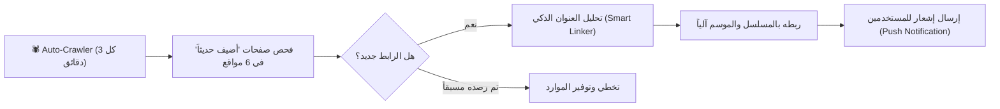

# 🎚️ دليل نظام الجودات المتعددة وموسم رمضان والربط التلقائي
## Multi-Quality Player, Ramadan Super Engine & Smart Media Linker

---

## 📑 محتويات الدليل
1. [التحكم في الجودات من داخل مشغل الفيديو (Multi-Quality Player)](#1-التحكم-في-الجودات-من-داخل-مشغل-الفيديو)
2. [النظام الشامل لموسم مسلسلات رمضان (Ramadan Super Engine)](#2-النظام-الشامل-لموسم-مسلسلات-رمضان)
3. [نظام الرصد والسحب الآلي للحلقات الجديدة (Real-Time Auto-Crawler)](#3-نظام-الرصد-والسحب-الآلي-للحلقات-الجديدة)
4. [نظام الربط الذكي وتوحيد المواسم وسلاسل الأفلام (Smart Media Linker)](#4-نظام-الربط-الذكي-وتوحيد-المواسم-وسلاسل-الأفلام)

---

## 1. التحكم في الجودات من داخل مشغل الفيديو

### أ. كيف يعمل النظام؟
1. بمجرد فتح أي فيلم أو حلقة، يقوم المشغل باستدعاء:
   ```http
   GET /api/cinema/quality?streamUrl=STREAM_URL
   ```
2. يقوم المحرك بفحص ملف الـ Master Playlist (`m3u8`) وقراءة وسم `#EXT-X-STREAM-INF`، واستخراج كافة الجودات المتاحة مع معدل البت (Bandwidth) والأبعاد بدقة:
   - **4K Ultra HD** (3840x2160)
   - **1080p Full HD** (1920x1080)
   - **720p HD** (1280x720)
   - **480p SD** (854x480)
   - **360p Low** (640x360)
   - **Auto (تكيف ذكي حسب سرعة النت)**
3. عند اختيار جودة جديدة، يقوم المشغل بالتبديل اللحظي مع **الاحتفاظ بزمن المشاهدة بالمللي ثانية** حتى لا يعيد الفيديو من البداية.

### ب. كود Flutter للتحكم في الجودة داخل المشغل (`QualitySelectorWidget.dart`)

```dart
import 'package:flutter/material.dart';
import 'package:video_player/video_player.dart';
import 'dart:convert';
import 'package:http/http.dart' as http;

class QualityOption {
  final String quality;
  final String label;
  final String url;
  final bool isDefault;

  QualityOption({
    required this.quality,
    required this.label,
    required this.url,
    this.isDefault = false,
  });

  factory QualityOption.fromJson(Map<String, dynamic> json) {
    return QualityOption(
      quality: json['quality'] ?? 'auto',
      label: json['label'] ?? 'تلقائي',
      url: json['url'] ?? '',
      isDefault: json['isDefault'] ?? false,
    );
  }
}

class MultiQualityPlayerController {
  static const String baseApiUrl = "http://localhost:3000";

  /// جلب كافة الجودات المتاحة لهذا البث
  static Future<List<QualityOption>> fetchAvailableQualities(String streamUrl) async {
    try {
      final endpoint = "$baseApiUrl/api/cinema/quality?streamUrl=${Uri.encodeComponent(streamUrl)}";
      final res = await http.get(Uri.parse(endpoint));
      if (res.statusCode == 200) {
        final data = json.decode(res.body);
        if (data['success'] == true && data['data']['tracks'] != null) {
          final tracks = data['data']['tracks'] as List;
          return tracks.map((t) => QualityOption.fromJson(t)).toList();
        }
      }
    } catch (e) {
      print("Error fetching qualities: $e");
    }
    return [];
  }

  /// تبديل الجودة بسلاسة مع الحفاظ التام على وقت المشاهدة
  static Future<VideoPlayerController> switchQuality({
    required VideoPlayerController currentController,
    required QualityOption selectedQuality,
  }) async {
    final currentPosition = currentController.value.position;
    final isPlaying = currentController.value.isPlaying;

    // إيقاف المشغل الحالي مؤقتاً
    await currentController.pause();
    currentController.dispose();

    // تشغيل الجودة الجديدة
    final newController = VideoPlayerController.networkUrl(
      Uri.parse(selectedQuality.url),
      httpHeaders: {'User-Agent': 'Mozilla/5.0'},
    );

    await newController.initialize();
    await newController.seekTo(currentPosition); // 🎯 استئناف من نفس الثانية بالضبط
    if (isPlaying) {
      newController.play();
    }

    return newController;
  }
}
```

---

## 2. النظام الشامل لموسم مسلسلات رمضان

### أ. ميزات النظام الرمضاني
* **التصنيف الجغرافي:** تصنيف دقيق (مسلسلات مصرية، شامية، خليجية، مغاربية، كوميديا، صعيدي).
* **جدول المواعيد والقنوات الناقلة:** معرفة القناة العارضة (MBC مصر، DMC، ON E، WatchIt، شاهد) وتوقيت العرض اليومي.
* **الرصد الفوري للحلقات:** سحب الحلقة فور انتهاء العرض التلفزيوني في أقل من 5 دقائق من أكثر من 5 مصادر (برستيج، عرب سيد، وي سيما، شاهد فور يو، أكوام).

### ب. استخدام الـ API في التطبيق:
```http
# 1. جلب مسلسلات رمضان حسب التصنيف
GET /api/cinema/ramadan?category=egyptian
GET /api/cinema/ramadan?category=syrian
GET /api/cinema/ramadan?category=gulf

# 2. جلب الحلقات المعروضة اليوم حصرياً (Live Feed)
GET /api/cinema/ramadan?live=true

# 3. جلب كافة حلقات وتفاصيل مسلسل معين
GET /api/cinema/ramadan?seriesId=ramadan_atawla
```

---

## 3. نظام الرصد والسحب الآلي للحلقات الجديدة (Auto-Crawler)

### أ. آلية العمل في الخلفية:


* **الرصد التلقائي:** يفحص صفحات "أضيف حديثاً" من عرب سيد، وي سيما، أكوام، فاصل، أنمي بلكم، وتورك فان.
* **دقة التحليل:** يستخرج اسم العمل، رقم الموسم، ورقم الحلقة فورياً.
* **الـ Webhook / Push:** مجهز بدالة `onNewRelease` لإرسال إشعارات FCM إلى هواتف المستخدمين: *"نزلت الآن الحلقة 15 من مسلسل العتاولة!"*

---

## 4. نظام الربط الذكي وتوحيد المواسم وسلاسل الأفلام

### أ. كيف يربط الحلقات بالمسلسلات والمواسم؟
إذا نشر موقع معين عنواناً مثل:
`"مسلسل العتاولة الموسم 2 الحلقة 14 HD اون لاين"`
يقوم محرك `SmartMediaLinker` بالآتي:
1. **تطبيع النص العربي:** إزالة علامات التشكيل، همزات الألف، والتاء المربوطة.
2. **استخراج الكيانات:**
   - اسم المسلسل الرئيسي: `"العتاولة"`
   - رقم الموسم: `2`
   - رقم الحلقة: `14`
3. **التجميع الذكي:** يتم وضع الحلقة 14 داخل الموسم 2 في مسجل مسلسل "العتاولة".
4. **دمج السيرفرات:** إذا كان عرب سيد يوفر سيرفرين، ووي سيما يوفر 3 سيرفرات أخرى لنفس الحلقة، يتم دمج الـ 5 سيرفرات تحت نفس الحلقة بدون أي تكرار!

### ب. كيف يربط أجزاء وسلاسل الأفلام (Franchises)؟
عند إضافة أي فيلم ينتمي لسلسلة (مثل ولاد رزق 1، 2، 3):
1. يتعرف المحرك على رقم الجزء من العنوان (`الجزء الثاني`, `2`, `Part 3`).
2. يقوم بإنشاء حاوية `"سلسلة أفلام ولاد رزق"`.
3. يرتب الأجزاء تصاعدياً من الجزء الأول حتى الأحدث.
4. يتيح للمستخدم في التطبيق الضغط على زر **"جميع أجزاء السلسلة"** لمشاهدة كافة الأجزاء مرتبة.

### ج. فحص الربط عبر الـ API:
```http
GET /api/cinema/franchise?title=ولاد رزق
GET /api/cinema/franchise?title=العتاولة
```
يرجع الشجرة الكاملة للمسلسل بجميع مواسمه وحلقاته وسيرفراته المدمجة بضغطة زر واحدة.
