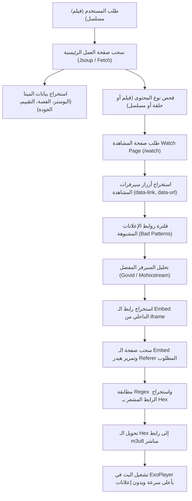

# 🎬 محرك سحب عرب سيد وتوليد البث المباشر (Arabseed Scraping & Stream Engine)
## التوثيق التقني لملف `ArabseedRepository.kt` و `arabseed.ts`

يقوم هذا المحرك بمهمة تفكيك واستخراج كامل محتوى السينما (أفلام، مسلسلات، حلقات، مواسم، وأجزاء) من موقع عرب سيد، وتحويل صفحات الويب الممتلئة بالإعلانات والـ Popups إلى بث مباشر نقي وسريع بصيغة HLS (`.m3u8`) أو MP4 يعمل مباشرة على مشغلات الفيديو دون أي إعلان.

---

## 1. الدورة الكاملة لعملية السحب (Scraping Lifecycle)



---

## 2. تخطي الحماية وهيدرز التمويه (Bypassing Protection & Header Spoofing)

مواقع البث المباشر تضع حماية تمنع استدعاء السيرفرات من خارج نطاقها (Hotlink Protection). تم حل هذه المشكلة عبر محاكاة متصفح كامل مع هيدرز مخصصة لكل خطوة:

### الهيدرز المستخدمة في سحب صفحات الموقع:
- **User-Agent:** محاكاة متصفح Chrome حديث على نظام Windows:
  `Mozilla/5.0 (Windows NT 10.0; Win64; x64) AppleWebKit/537.36 (KHTML, like Gecko) Chrome/124.0.0.0 Safari/537.36`
- **Referer:** يتم إرسال رابط موقع عرب سيد كنطاق مرجعي (`https://arabseed.health/`).
- **Accept-Language:** `ar,en-US;q=0.9,en;q=0.8` (لضمان استرجاع المحتوى باللغة العربية).
- **CookieJar الذاتي:** تطبيق `CookieJar` في OkHttpClient لحفظ الكوكيز المتبادلة وتخطي حمايات Cloudflare البسيطة ومسار الجلسة.

---

## 3. تمييز وتصنيف الأعمال (Movies vs Series vs Episodes)

أحد أكبر التحديات في المواقع السينمائية هو أن روابط الحلقات الفردية غالبًا ما تبدو في هيكلية الـ HTML كفيلم منفصل. تم بناء نظام ذكي (`isSeriesLike`) لفحص الكلمات الدلالية:

```kotlin
val isSeriesLike = href.contains("مسلسل") || href.contains("series")
    || title.contains("مسلسل") || rawTitle.contains("مسلسل")
    || title.contains("الحلقة") || rawTitle.contains("الحلقة")
    || title.contains("الموسم") || rawTitle.contains("الموسم")
    || title.contains("حلقة") || rawTitle.contains("حلقة")
    || title.contains("موسم") || rawTitle.contains("موسم")
    || href.contains("episode") || href.contains("season")
```

إذا وُجدت أي من هذه الكلمات، يتم تحويل النوع فوراً إلى `ArabseedType.SERIES` لتمكين محرك الحلقات والأجزاء.

---

## 4. شجرة التتبع الذاتي للحلقات (Breadcrumb Traversal)

عندما يفتح المستخدم رابط حلقة مباشرة (مثل: `مسلسل قيامة عثمان الحلقة 15`)، فإن صفحة الحلقة في العادة لا تحتوي على قائمة الحلقات بالكامل، بل تحتوي فقط على مشغل تلك الحلقة.

**كيف يتعامل المحرك مع ذلك؟**
1. يبحث عن محددات الحلقات داخل الصفحة أولاً:
   `a.episode__item`, `a[href*='الحلقة']`, `.Episodes--List a`, `.eps li a`, إلخ.
2. إذا وجد حلقة واحدة فقط أو لم يجد، يقوم المحرك بـ **Breadcrumb Traversal** (تسلق شجرة المسار):
   - يقرأ مسار الصفحة (`.breadcrumb a`, `.SeriesTitle a`, `a.SeriesLink`).
   - يستخرج رابط المسلسل الأب (Parent Series URL).
   - يقوم بجلب صفحة المسلسل الأب في الخلفية ويستخرج جميع الحلقات والمواسم منها.

---

## 5. محرك استكشاف الأجزاء والمواسم الأخرى (Related Parts Discovery)

تم تزويد المنظومة بطريقتين للعثور على الأجزاء السابقة واللاحقة للعمل:

1. **السحب المباشر من محددات الصفحة:**
   يقوم بفحص عناصر HTML التي تحتوي على كلمات `جزء` أو `موسم` أو روابط `/series/`:
   ```kotlin
   val isPart = txt.contains("جزء") || txt.contains("موسم") || txt.contains("الجزء") || txt.contains("الموسم")
       || href.contains("season") || href.contains("part") || href.contains("/series/")
   ```
2. **البحث التلقائي الذكي (Smart Title Search Fallback):**
   إذا لم تكن الأجزاء مربوطة بروابط صريحة في الـ HTML، يقوم المحرك بتنظيف اسم العمل واستخراج الاسم المجرد:
   - حذف كلمات: `الموسم 1`, `الجزء 2`, `الحلقة 5`, `مترجم`, `مدبلج`, `1080p`, إلخ.
   - إرسال طلب بحث داخلي بالاسم الأصلي للعمل.
   - تجميع كافة المواسم والأجزاء التي تطابق الاسم وعرضها في صفحة التفاصيل أسفل السيرفرات مباشرة.

---

## 6. استخراج روابط التشغيل وسيرفرات البث (Server Extraction)

في صفحة العمل، تكون سيرفرات المشاهدة مخبأة داخل صفحة فرعية تنتهي بـ `/watch`. المحرك يطلب هذه الصفحة ويفحص السمات (Attributes) التالية:

1. **`[data-link]`**: الرابط المباشر لمشغل الفيديو.
2. **`[data-url]`, `[data-src]`, `[data-embed]`**: روابط بديلة لمشغلات مختلفة.
3. **`iframe[src]`**: المشغل المضمن الافتراضي.

### فلترة الإعلانات والمواقع الخبيثة (`_badPatterns`):
يتم فحص الرابط ومقارنته بقائمة سوداء مشفرة تتضمن أشهر نطاقات الإعلانات والروابط الوهمية:
- استبعاد أي رابط يحتوي على كلمات مثل `ad`, `pop`, `bet`, `affiliate`, `redirect`, إلخ.
- لا يتم قبول السيرفر إلا إذا كان يبدأ بـ `http` ويؤدي إلى مشغل فيديو حقيقي.

---

## 7. فك تشفير سيرفر Govid و Mohixstream واستخراج الـ m3u8

سيرفر **Govid** هو السيرفر الأسرع والأفضل، لكنه يخفي رابط الـ m3u8 عبر تقنيات متعددة:

1. **الخطوة الأولى:** طلب صفحة `govid.live/play/...` مع وضع هيدر `Referer: https://arabseed.health/`.
2. **الخطوة الثانية:** استخراج رابط iframe مضمن (Embed URL) الذي يشير عادة لنطاق البث الخاص بهم مثل `mohixstream.xyz`.
3. **الخطوة الثالثة:** طلب صفحة الـ Embed مع وضع هيدر `Referer: https://govid.live/`.
4. **الخطوة الرابعة (فك تشفير الـ Hex):**
   تتضمن صفحة المشغل دالة JavaScript تحتوي على كود Hex مشفر. يقوم الـ Regex باصطياد النص المسداسي (Hex String):
   ```kotlin
   val matcher = Pattern.compile(MOHIX_RE).matcher(embedHtml)
   if (matcher.find()) {
       val direct = hexToString(matcher.group(1))
       // النتيجة: رابط مباشر ينتهي بـ .m3u8 أو .mp4
   }
   ```
5. **الخطوة الخامسة:** تمرير رابط الـ `.m3u8` إلى `ExoPlayer` في الأندرويد أو `video.js` في الويب لتشغيل العمل بأعلى سرعة ممكنة دون فتح أي إعلان على الإطلاق.
