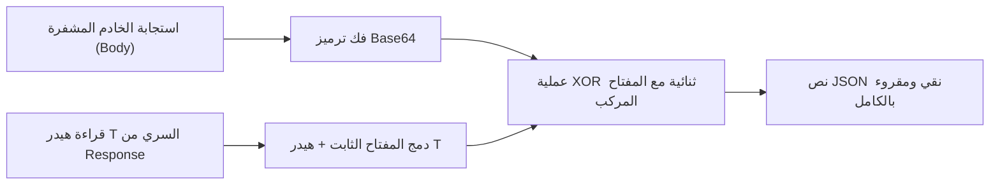

# 📡 محرك ياسين تيفي وفك تشفير الـ API (Yacine TV Decryption Engine)
## التوثيق التقني لملف `YacineRepository.kt` و `YacineStreamPlayer.kt`

يُعتبر تطبيق ياسين تيفي (Yacine TV) المصدر الأبرز للبث المباشر للقنوات المشفرة (مثل باقات beIN Sports و SSC و OSN وغيرها). يقوم هذا المحرك باستخراج بيانات وسيرفرات القنوات مباشرة من الخوادم السحابية الخاصة بياسين تيفي وفك تشفيرها بالكامل بدون الحاجة لتثبيت تطبيق ياسين أو مشغله الخارجي YTV Player.

---

## 1. البنية المعمارية لـ API ياسين تيفي

تعتمد خوادم ياسين تيفي على نقطة وصول API سرية ومحمية:
- **نطاق الخادم الأساسي (Base URL):** `https://def001.ycnapi.com/api`
- **نقاط النهاية (Endpoints):**
  - `/categories`: جلب باقات القنوات (beIN Sports, الرياضة العربية, قنوات وياك, قنوات الأطفال, إلخ).
  - `/categories/{id}/channels`: جلب قائمة القنوات التابعة لباقة معينة.
  - `/channel/{id}`: جلب سيرفرات وجودات البث المتاحة لقناة معينة.
  - `/events`: جلب مباريات اليوم المشفرة المنقولة عبر القنوات.

---

## 2. بروتوكول المصادقة والحماية (Authentication & Spoofing)

تفرض خوادم ياسين تيفي حماية صارمة لمنع الوصول لبياناتها من خارج التطبيق الرسمي:
1. **التحقق من معرف الحزمة (Package Verification):**
   تطلب الخوادم هيدر خاص يُسمى `x-android-package`، ويجب أن تتطابق قيمته مع المعرف الرسمي لتطبيق ياسين:
   ```
   x-android-package: ver3.ycntivi.off
   ```
   إذا لم يُرسل هذا الهيدر أو أُرسل باسم حزمة مختلف، يرفض الخادم الطلب برمز `403 Forbidden`.
2. **التحقق من هيدر الـ User-Agent:**
   يتم إرسال User-Agent مخصص لمحاكاة تطبيق الأندرويد الأصلي لياسين تيفي.

---

## 3. خوارزمية فك التشفير الديناميكية (The Dynamic Decryption Algorithm)

خوادم ياسين تيفي **لا ترجع نصوص JSON عادية**، بل ترجع استجابة مشفرة بخوارزمية XOR ديناميكية معقدة تعتمد على هيدر سري يتغير مع كل طلب (`T` أو `t`):



### كود فك التشفير الفعلي (Kotlin Implementation):

```kotlin
// المفتاح السري الثابت المستخرج من هندسة كود ياسين
private val HARDCODED_KEY = "c!xZj+N9&G@Ev@vw"

private fun decrypt(body: String, tHeader: String): String {
    // 1. تكوين المفتاح الديناميكي بدمج المفتاح الثابت مع الهيدر T القادم من الخادم
    val key = (HARDCODED_KEY + tHeader).toByteArray(Charsets.UTF_8)
    
    // 2. فك ترميز الـ Base64 لجسم الاستجابة
    val decoded = Base64.decode(body.trim(), Base64.DEFAULT)
    
    // 3. تطبيق خوارزمية XOR الدائرية على كل بايت
    val result = ByteArray(decoded.size) { i ->
        (decoded[i].toInt() xor key[i % key.size].toInt()).toByte()
    }
    
    // 4. تحويل الناتج إلى نص JSON سليم
    return String(result, Charsets.UTF_8)
}
```

---

## 4. استخراج روابط البث وتشغيلها على ExoPlayer

عند استدعاء `/channel/{id}`، ترجع بيانات القناة مصفوفة من السيرفرات وجودات مختلفة (4K, 1080p, 720p, 360p, Low). كل سيرفر يحتوي على:
- `url`: رابط بث مباشر بصيغة HLS (`.m3u8`).
- `userAgent`: الـ User-Agent المطلوب لتشغيل هذا الرابط.
- `referer`: الرابط المرجعي لمنع حظر مزود السيرفر (Akamai أو Cloudflare).

### تهيئة مشغل ExoPlayer في `YacineStreamPlayer.kt`:
```kotlin
val dataSourceFactory = DefaultHttpDataSource.Factory()
    .setUserAgent(stream.userAgent)
    .setAllowCrossProtocolRedirects(true)
    .setConnectTimeoutMs(8000)
    .setReadTimeoutMs(10000)
    .setDefaultRequestProperties(
        buildMap {
            put("User-Agent", stream.userAgent)
            if (stream.referer.isNotEmpty()) put("Referer", stream.referer)
        }
    )

val mediaSource = HlsMediaSource.Factory(dataSourceFactory)
    .createMediaSource(MediaItem.fromUri(stream.url))

exoPlayer.setMediaSource(mediaSource)
exoPlayer.prepare()
exoPlayer.playWhenReady = true
```

---

## 5. نظام إخفاء العلامة المائية والشعار (Mashad Watermark Overlay)

تقوم بعض سيرفرات ياسين تيفي بوضع علامة مائية وشعار في الزاوية السفلية اليسرى من البث المباشر. تم ابتكار نظام تمويه ذكي واحترافي في واجهة التطبيق عبر المكون:
`MashadWatermarkBadge`

### آلية العمل:
- تم تثبيت طبقة Composable فوق الـ Video Surface مباشرة بمحاذاة الزاوية السفلية اليسرى (`Alignment.BottomStart`).
- أبعاد الشارة مدروسة بدقة (`width: 175.dp`, `height: 52.dp`, `padding: 12.dp`) لتغطي أي شعار خارجي بالكامل وبشكل متناسق.
- تصميم الشارة فاخر ومتناسق مع هوية تطبيق مشهد (إطار ذهبي `Color(0xFFD4AF37)` مع خلفية ليلية داكنة ولوجو التطبيق الرسمي)، لتبدو وكأنها ميزة حصرية وبث رسمي خاص بالمنصة.
