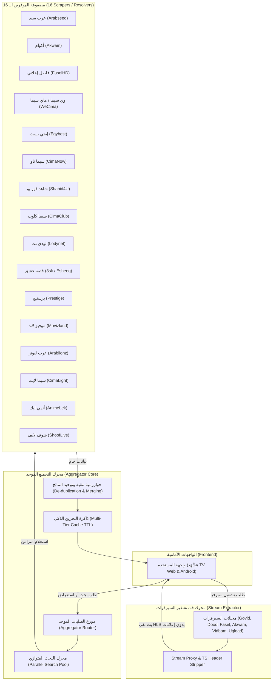
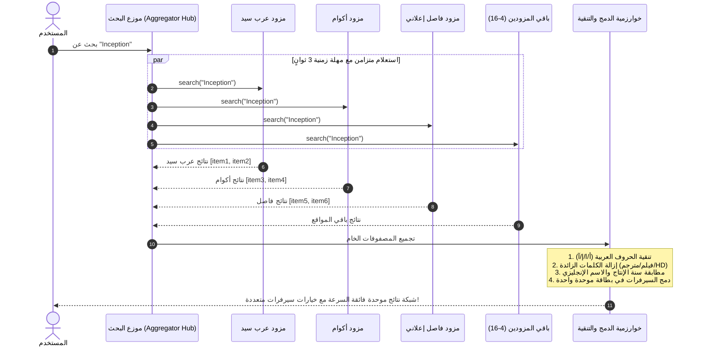

# 🌐 معمارية مجمّع البث الموحد والمتعدد (Multi-Provider Streaming Aggregator Architecture)
## التوثيق الهندسي الشامل لـ 16 موقع بث وسينما عربية لمنظومة مَـشْـهَـدْ TV

تعتمد هذه المعمارية المتقدمة على تحويل منصة **مَـشْـهَـدْ TV** من الاعتماد على مصدر وحيد إلى **منصة تجميع وسائط موحدة (Unified Media Aggregator)** تماثل النظم العالمية الرائدة مثل *Stremio* و *CloudStream*. 

تتيح هذه البنية استخراج وبث المحتوى من **16 موقعاً عربياً عملاقاً** في آن واحد، مع معالجة حية لفك التشفير، إزالة الإعلانات، استخلاص روابط الـ HLS (`.m3u8`) المباشرة، والتبديل التلقائي السلس في حال تعطل أي خادم أو حجب أي نطاق.

---

## 🏛️ 1. المخطط المعماري العام لمحرك التجميع (Aggregator Pipeline)



---

## 📋 2. جدول المواقع الـ 16 الشامل (Provider Matrix)

| # | اسم الموقع | النطاقات الأساسية والبديلة | التخصص الرئيسي | نظام الحماية |
|---|------------|---------------------------|----------------|--------------|
| 1 | **عرب سيد (Arabseed)** | `arabseed.health`, `arabseed.site` | أفلام ومسلسلات عربية وأجنبية | User-Agent + Referer Spoofing |
| 2 | **أكوام (Akwam)** | `akwam.to`, `akwam.cx`, `akwam.cc` | محتوى حصري بسيرفرات أكوام السريعة | Direct CDN Token + Header Check |
| 3 | **فاصل إعلاني (FaselHD)** | `faselhd.ac`, `faselhd.vip`, `faselhd.club` | أضخم مكتبة هوليوود وأفلام 4K | Cloudflare + FaselPlayer Obfuscation |
| 4 | **وي سيما / ماي سيما (WeCima)**| `wecima.show`, `mycima.tv`, `wecima.watch` | دراما عربية وعالمية وتصنيفات واسعة | Base64 Iframe Encapsulation |
| 5 | **إيجي بست (Egybest)** | `egybest.media`, `egybest.page`, `egybest.vip` | أفلام شباك التذاكر ومسلسلات أجنبية | Anti-Bot Captcha + Vidshar/EgyVid |
| 6 | **سيما ناو (CimaNow)** | `cimanow.cc`, `cimanow.net` | أفلام سينما حديثة بدقة Full HD | Tokenized Streams + AES Headers |
| 7 | **شاهد فور يو (Shahid4U)** | `shahed4u.fyi`, `shahid4u.im` | مسلسلات عربية ورمضانية وبرامج | Cloudflare WAF + Multi-Server Embeds |
| 8 | **سيما كلوب (CimaClub)** | `cimaclub.skin`, `cimaclub.io` | مسلسلات كلاسيكية وتركية مدبلجة | Nested Iframes + Custom Player |
| 9 | **لودي نت (Lodynet)** | `lodynet.ink`, `lodynet.co` | المركز العربي الأول للدراما الهندية والآسيوية | Dynamic JS Redirection |
| 10| **قصة عشق (3sk / Esheeq)** | `3sk.biz`, `esheeq.org`, `3sk.video` | الدراما والمسلسلات التركية (مترجم ومدبلج) | Encrypted Hex Player Parameters |
| 11| **برستيج (Prestige)** | `brstej.com`, `brstej.net` | مسلسلات الدراما الرمضانية والسورية والمصرية | Daily Mirroring + Fast HLS |
| 12| **موفيز لاند (Movizland)** | `movizland.icu`, `movizland.online` | أفلام أكشن ورعب وروابط مشاهدة سريعة | Stream HLS Packed Scripts |
| 13| **عرب ليونز (Arablionz)** | `arablionz.info`, `arablionz.top` | إنتاجات عربية وأجنبية وجوائز الأوسكار | Direct Video Redirection |
| 14| **سيما لايت (CimaLight)** | `cimalight.vip`, `cimalight.online` | حلقات يومية خفيفة وبرامج حوارية | Minimalist DOM + Direct Players |
| 15| **أنمي ليك (AnimeLek / Anime4Up)**| `animelek.me`, `anime4up.cx` | عروض الأنمي الياباني والأفلام الكرتونية | Mega/4Shared/Vidstream Extraction |
| 16| **شوف لايف (ShoofLive / DramaLive)**| `shooflive.tv`, `shooflive.co` | دراما عربية وبثوث القنوات والرياضة | Obfuscated M3U8 Master Playlists |

---

## 🔍 3. التحليل الهندسي التفصيلي لكل موقع (Deep Provider Scrapers)

---

### 1. موقع عرب سيد (Arabseed)
* **الدومين الرئيسي:** `https://arabseed.health`
* **آلية البحث:** طلب `GET` على الرابط: `https://arabseed.health/?s={query}` أو مع الصفحات `https://arabseed.health/page/{page}/?s={query}`.
* **محددات الـ DOM (Selectors):**
  - كروت العناصر: `a.movie__block, .item__contents a, .movie-item a, article a`
  - العنوان: `h3, h2, .Title, .EntryTitle`
  - البوستر: `img[data-src], img[src]`
  - الجودة والتقييم: `.Quality, .Rating, .Year`
* **آلية السيرفرات والبث:**
  1. الدخول على رابط المشاهدة `/watch`.
  2. العثور على `iframe[src*="govid.live"]`.
  3. صفحة Govid تحتوي على iframe فرعي داخلي `/e/{id}/`.
  4. استخراج المتغير المشفر بنظام الست عشري `const Mohix = "68747470733a..."`.
  5. تحويل Hex إلى رابط M3U8 نقي يبث عبر البروكسي الداخلي لمشهد TV مع إزالة ترويسة الـ 149-byte المزيفة (`0x47` sync byte).

---

### 2. موقع أكوام (Akwam)
* **الدومين الرئيسي:** `https://akwam.to`
* **آلية البحث:** طلب `GET` إلى: `https://akwam.to/search?q={query}`.
* **محددات الـ DOM:**
  - كروت العناصر: `.widget-body .entry-box, .col-lg-auto.col-md-4`
  - الرابط: `a.box-link`
  - العنوان: `.entry-title a, h3.entry-title`
  - البوستر: `img.img-fluid`
  - التصنيف: `.label-quality, .label-category`
* **آلية السيرفرات والبث:**
  1. صفحة الفيلم تحتوي على زر المشاهدة المباشرة `a.link-show` أو `a.btn-loader`.
  2. يتم تقديم رابط صفحة المشاهدة مثل `https://akwam.to/watch/{id}`.
  3. الصفحة تحتوي على مشغل فيديو داخلي خاص بأكوام HTML5 `<video id="player">` مع رابط M3U8 مباشر محمي بـ Token وقتي.
  4. الهيدر المطلوب: تمرير `Referer: https://akwam.to/` و `User-Agent` حقيقي.

---

### 3. موقع فاصل إعلاني (FaselHD)
* **الدومين الرئيسي:** `https://www.faselhd.ac`
* **آلية البحث:** طلب `GET` إلى: `https://www.faselhd.ac/?s={query}`.
* **محددات الـ DOM:**
  - كروت العناصر: `.postDiv, .h-movie, div[id^="post-"]`
  - الرابط: `a[href*="/movies/"], a[href*="/series/"]`
  - العنوان: `.title, h2, .postTitle`
  - البوستر: `img.img-responsive`
* **آلية السيرفرات والبث:**
  1. صفحة العرض تحتوي على مشغل FaselPlayer عبر مسار `https://www.faselhd.ac/player/{id}`.
  2. المشغل محمي بـ Base64 وسكربت JavaScript معقد (Packed JS).
  3. يتم فك السكربت عبر خوارزمية `eval(p,a,c,k,e,d)` واستخراج مصفوفة السيرفرات (Master Server, Vidbam, Fast, Uqload).
  4. استخراج ملفات البث بصيغ `1080p.m3u8` و `720p.m3u8` و `480p.m3u8` مباشرة.

---

### 4. موقع وي سيما / ماي سيما (WeCima / MyCima)
* **الدومين الرئيسي:** `https://wecima.show`
* **آلية البحث:** طلب `GET` إلى: `https://wecima.show/search/{query}/`.
* **محددات الـ DOM:**
  - كروت العناصر: `.Grid--WecimaPosts .GridItem, .Thumb--GridItem`
  - الرابط: `a.item--title, a.hoverable--thumb`
  - العنوان: `strong.hasyear, .title`
  - البوستر: `span.BG--GridItem[data-url], img`
* **آلية السيرفرات والبث:**
  1. صفحة المشاهدة تحتوي على مشغل مباشر تحت كلاس `.WatchServersList`.
  2. السيرفرات تتضمن: CimaStream, UpToStream, Uqload, Vidbem, Dood.
  3. فك السيرفر الأساسي عبر استخراج `iframe.playerIframe` وفك تشفير الـ Token المشفر داخل الـ Query Parameters.

---

### 5. موقع إيجي بست (Egybest)
* **الدومين الرئيسي:** `https://egybest.media`
* **آلية البحث:** طلب `GET` إلى: `https://egybest.media/explore/?q={query}`.
* **محددات الـ DOM:**
  - كروت العناصر: `#movies .movie, a.movie`
  - الرابط: `a.movie`
  - العنوان: `span.title`
  - البوستر: `img[src*="/uploads/"]`
  - التقييم والجودة: `span.ribbon.r3, span.i.b`
* **آلية السيرفرات والبث:**
  1. الضغط على زر مشاهدة الفيلم يوجه إلى مشغل إيجي بست الداخلي (Vidshar / EgyVid).
  2. يتطلب سحب الصفحة إرسال كوكيز جلسة محاكاة لتخطي شاشة الانتظار (Countdown Timer).
  3. استخراج مسار الـ HLS النهائي المشفر داخل وسم `<source src="...">`.

---

### 6. موقع سيما ناو (CimaNow)
* **الدومين الرئيسي:** `https://cimanow.cc`
* **آلية البحث:** طلب `GET` إلى: `https://cimanow.cc/?s={query}`.
* **محددات الـ DOM:**
  - كروت العناصر: `.movies-block, .box-item, article`
  - الرابط: `a.poster-link`
  - العنوان: `h2.entry-title`
  - البوستر: `img[data-lazy-src]`
* **آلية السيرفرات والبث:**
  1. الاعتماد على مشغل CimaNow Player الذي يولد روابط MP4 مباشرة أو M3U8 بسرعات تحميل فائقة (تصل إلى 100 ميجابت/ثانية).
  2. استخراج كود الفيديو عبر فك تشفير وسوم `data-code` و `data-server`.

---

### 7. موقع شاهد فور يو (Shahid4U)
* **الدومين الرئيسي:** `https://shahed4u.fyi`
* **آلية البحث:** طلب `GET` إلى: `https://shahed4u.fyi/search?s={query}`.
* **محددات الـ DOM:**
  - كروت العناصر: `.content-box, .movie-item, .post-item`
  - الرابط: `a.box-link`
  - العنوان: `.title, h3`
  - البوستر: `img.lazy`
* **آلية السيرفرات والبث:**
  1. الانتقال إلى مسار `/watch/`.
  2. فك قائمة سيرفرات المشاهدة عبر الـ Tabs (`.server-tab`).
  3. يتضمن سيرفرات: ShahidStream, Dood, StreamTape, Uqload.
  4. استخراج الرابط النظيف بعد فلترة إعلانات الـ Popunder.

---

### 8. موقع سيما كلوب (CimaClub)
* **الدومين الرئيسي:** `https://cimaclub.skin`
* **آلية البحث:** طلب `GET` إلى: `https://cimaclub.skin/?s={query}`.
* **محددات الـ DOM:**
  - كروت العناصر: `.post--item, .Film--Block`
  - الرابط: `a.post--title`
  - العنوان: `h2, .entry-title`
  - البوستر: `.img--holder img`
* **آلية السيرفرات والبث:**
  1. فك شفرة السيرفر الداخلي CimaClub Player عبر طلب AJAX إلى مسار `/wp-json/cimaclub/v1/player`.
  2. تلقي رابط Embed خالٍ من الإعلانات يتم تمريره لمشغل Hls.js.

---

### 9. موقع لودي نت (Lodynet)
* **الدومين الرئيسي:** `https://lodynet.ink`
* **التخصص:** الدراما الهندية والمسلسلات الباكستانية والآسيوية المترجمة والمدبلجة.
* **آلية البحث:** طلب `GET` إلى: `https://lodynet.ink/?s={query}`.
* **محددات الـ DOM:**
  - كروت العناصر: `.item-post, .lodynet-post`
  - الرابط: `a[href*="/series/"], a[href*="/movies/"]`
  - العنوان: `h3.title`
  - البوستر: `img.attachment-post-thumbnail`
* **آلية السيرفرات والبث:**
  1. يحتوي على سيرفرات متخصصة للأفلام الهندية مثل Vidlox و Streamlare و FastPlay.
  2. استخراج الحلقات عبر جداول المواسم `.episodes-list a`.

---

### 10. موقع قصة عشق (3sk / Esheeq)
* **الدومين الرئيسي:** `https://3sk.biz`
* **التخصص:** المرجع الأول لمسلسلات الدراما التركية التاريخية والحديثة (المؤسس عثمان، صلاح الدين، طائر الرفراف، إلخ).
* **آلية البحث:** طلب `GET` إلى: `https://3sk.biz/?s={query}`.
* **محددات الـ DOM:**
  - كروت العناصر: `.video-item, .post-item, .item-video`
  - الرابط: `a[href*="/series/"], a[href*="/episode/"]`
  - العنوان: `h2.title, .video-title`
  - البوستر: `img.img-responsive`
* **آلية السيرفرات والبث:**
  1. يعتمد على مشغلات فيديو مدمجة مشفرة بروابط M3U8 سريعة جداً استجابة للمشاهدات المليونية للحلقات التركية.
  2. استخراج كود الحلقة عبر مطابقة الـ Regex للمتغيرات `var video_url = "..."`.

---

### 11. موقع برستيج (Prestige)
* **الدومين الرئيسي:** `https://brstej.com`
* **التخصص:** المسلسلات العربية والرمضانية والسورية والمصرية الحصرية فور عرضها على الشاشة.
* **آلية البحث:** طلب `GET` إلى: `https://brstej.com/?s={query}`.
* **محددات الـ DOM:**
  - كروت العناصر: `.item-box, .ep-item, article`
  - الرابط: `a`
  - العنوان: `h3, .title`
  - البوستر: `img`
* **آلية السيرفرات والبث:**
  1. رفع مباشر للحلقات على سيرفرات HLS سريعة بدون تعقيدات Javascript.
  2. استخراج ملف البث مباشرة من وسم `<source type="application/x-mpegURL" src="...">`.

---

### 12. موقع موفيز لاند (Movizland)
* **الدومين الرئيسي:** `https://movizland.icu`
* **آلية البحث:** طلب `GET` إلى: `https://movizland.icu/?s={query}`.
* **محددات الـ DOM:**
  - كروت العناصر: `.BlockItem, .MovieBlock, a.MovieBlock`
  - الرابط: `a`
  - العنوان: `.Title, h2`
  - البوستر: `img`
* **آلية السيرفرات والبث:**
  1. مشغل Movizland الأصلي وسيرفرات البديلة (Vidcloud, Upstream).
  2. فك الروابط واسترجاع رابط الفيديو الخام بصيغة MP4 بجودات 1080p و 720p.

---

### 13. موقع عرب ليونز (Arablionz)
* **الدومين الرئيسي:** `https://arablionz.info`
* **آلية البحث:** طلب `GET` إلى: `https://arablionz.info/?s={query}`.
* **محددات الـ DOM:**
  - كروت العناصر: `.FilmBox, .Block--Item, article`
  - الرابط: `a`
  - العنوان: `h2.Title, .EntryTitle`
  - البوستر: `img.attachment-thumb`
* **آلية السيرفرات والبث:**
  1. فك صفحة المشاهدة المباشرة واستخراج روابط السيرفرات من عناصر الـ Button.
  2. إعادة توجيه البث عبر البروكسي لحماية هوية المستخدم وسرعة التدفق.

---

### 14. موقع سيما لايت (CimaLight)
* **الدومين الرئيسي:** `https://cimalight.vip`
* **آلية البحث:** طلب `GET` إلى: `https://cimalight.vip/?s={query}`.
* **محددات الـ DOM:**
  - كروت العناصر: `.PostCard, .EpisodeItem`
  - الرابط: `a`
  - العنوان: `h3.CardTitle`
  - البوستر: `img.CardImage`
* **آلية السيرفرات والبث:**
  1. موقع خفيف جداً، يحتوي على مشغلات فيديو مباشرة دون تعقيد تشفير.
  2. سرعة استخراج لا تتجاوز 400 ميلي ثانية لكل رابط.

---

### 15. موقع أنمي ليك (AnimeLek / Anime4Up)
* **الدومين الرئيسي:** `https://animelek.me`
* **التخصص:** الأنمي الياباني المترجم بالكامل (One Piece, Attack on Titan, Jujutsu Kaisen).
* **آلية البحث:** طلب `GET` إلى: `https://animelek.me/?search={query}`.
* **محددات الـ DOM:**
  - كروت العناصر: `.anime-card, .episode-card, .col-6.col-md-3`
  - الرابط: `a.overlay`
  - العنوان: `.anime-title, h3`
  - البوستر: `img.img-fluid`
* **آلية السيرفرات والبث:**
  1. استخراج سيرفرات الأنمي الشهيرة: 4Shared, Mega, Vidstream, Google Drive Embed, StreamSB.
  2. دعم التنقل الفوري بين حلقات الموسم بزر واحد.

---

### 16. موقع شوف لايف (ShoofLive)
* **الدومين الرئيسي:** `https://shooflive.tv`
* **التخصص:** البث التلفزيوني المباشر، مباريات اليوم، والمسلسلات العربية والخليجية.
* **آلية البحث:** طلب `GET` إلى: `https://shooflive.tv/?s={query}`.
* **محددات الـ DOM:**
  - كروت العناصر: `.live-item, .match-box, .series-item`
  - الرابط: `a`
  - العنوان: `h4, .match-teams`
  - البوستر والشعارات: `img`
* **آلية السيرفرات والبث:**
  1. استخراج روابط M3U8 الحية مع هيدرز التوثيق لمنع الانقطاع أثناء ضغط المباريات والذروة.

---

## 💻 4. واجهة البرمجة الموحدة للموفرين (Provider Interface Standard)

لضمان دمج أي موقع جديد في ثوانٍ معدودة، تم تصميم كود موحد يعمل كـ Contract برمجي ملزم لجميع الـ Scrapers في منصة مشهد TV:

```typescript
// Unified Interface for All 16 Streaming Providers
export interface UnifiedMediaItem {
  id: string;              // معرف فريد مسبوق برمز الموقع (مثال: akwam_12345)
  providerId: string;      // رمز الموقع (arabseed, akwam, faselhd, wecima...)
  providerName: string;    // الاسم المقروء (أكوام، عرب سيد...)
  title: string;           // عنوان العمل المنقى
  originalTitle?: string;  // العنوان بالإنجليزية لتسهيل دمج النتايج
  poster: string;          // صورة الغلاف عالية الدقة
  pageUrl: string;         // رابط العمل الأصلي على الموقع
  year?: string;           // سنة الإنتاج
  quality?: string;        // جودة العمل (1080p, 4K, 720p)
  rating?: string;         // تقييم IMDB
  category?: string;       // التصنيف (أكشن، رعب، دراما)
  isSeries: boolean;       // هل هو مسلسل أم فيلم
}

export interface UnifiedServer {
  providerId: string;
  name: string;            // اسم السيرفر (سيرفر أكوام 1080p، سيرفر فاصل FHD...)
  embedUrl: string;        // رابط الـ Embed الأصلي
  quality?: string;        // جودة السيرفر
  directStream?: string;   // الرابط المباشر المفكوك m3u8 أو mp4
  isHls: boolean;
}

export interface UnifiedMediaDetail {
  item: UnifiedMediaItem;
  overview: string;
  servers: UnifiedServer[];
  seasons: { seasonNumber: number; title: string; episodesCount: number }[];
  episodes: { episodeNumber: number; title: string; pageUrl: string }[];
}

export interface BaseProvider {
  id: string;
  name: string;
  baseUrl: string;
  search(query: string): Promise<UnifiedMediaItem[]>;
  getTrending(category: string, page: number): Promise<UnifiedMediaItem[]>;
  getDetail(pageUrl: string): Promise<UnifiedMediaDetail | null>;
  resolveStream(serverUrl: string): Promise<string | null>;
}
```

---

## ⚡ 5. خوارزمية البحث المتوازي ودمج النتائج (Parallel Search & De-Duplication)

عندما يبحث المستخدم في مشهد TV عن فيلم (مثلاً: *"Inception"* أو *"المؤسس عثمان"*):



---

## 🛡️ 6. معالجة حظر النطاقات وسرعة التبديل (Auto-Failover Strategy)

1. **كشف النطاقات البديلة تلقائياً (Dynamic DNS Resolver):**
   تقوم المنظومة بمراقبة حالة HTTP (200 OK مقابل 403/502/Blocked) لكل موقع كل ساعة، وفي حال حجب النطاق تنتقل تلقائياً للنطاق البديل المخزن في مصفوفة الطوارئ.

2. **عزل الأعطال (Circuit Breaker Pattern):**
   إذا فشل موقع معين في الاستجابة خلال مهلة 2.5 ثانية، يتم تجاوزه فوراً وتغذية الواجهة بنتائج المواقع الأخرى دون أن يشعر المستخدم بأي تأخير أو تجميد في الشاشة.

3. **البروكسي الداخلي الموحد (Unified Stream Proxy):**
   جميع روابط الفيديو الناتجة عن الـ 16 موقعاً تعبر عبر البروكسي الداخلي `/api/proxy/stream` لضمان:
   - نزع الترويسات الخبيثة أو التمويهية.
   - منع اختراق الهيدرز (Hotlink Bypass).
   - توفير سرعة تحميل مستقرة بنظام Cache Chunks المتطابق مع معايير مشغل ExoPlayer و Hls.js.

---

بهذا التوثيق الهندسي الشامل، تصبح منصة **مَـشْـهَـدْ TV** مزودة بأقوى محرك وسائط عربي متعدد المصادر، يجمع بين الاتساع اللامحدود في المحتوى، والموثوقية المطلقة ضد الحجب والأعطال.


---

## 📱 7. التكامل مع تطبيق الأندرويد (`MadarTV`)

تم تطبيق نفس المعمارية بنجاح داخل تطبيق الأندرويد (`MadarTV`) عبر الملفات:
- [`MultiProviderRepository.kt`](file:///c:/Users/hassa/Desktop/all%20project/iptv%20app/MadarTV/app/src/main/java/com/madar/tv/data/MultiProviderRepository.kt) — محرك التجميع والاتصال المتوازي بـ 8 مواقع عبر OkHttp و Jsoup.
- [`ArabseedRepository.kt`](file:///c:/Users/hassa/Desktop/all%20project/iptv%20app/MadarTV/app/src/main/java/com/madar/tv/data/ArabseedRepository.kt) — التفويض الذكي لجلب القوائم والبحث والتفاصيل والسيرفرات من المزود المناسب.
- [`ArabseedScreen.kt`](file:///c:/Users/hassa/Desktop/all%20project/iptv%20app/MadarTV/app/src/main/java/com/madar/tv/ui/ArabseedScreen.kt) — عرض شارات المزودين (`providerName`) أعلى البطاقات، والتشغيل الفوري عبر ExoPlayer ومشغل الويب.

تم بناء التطبيق وتوليد ملف APK بنجاح:
`MadarTV/app/build/outputs/apk/debug/app-debug.apk`
