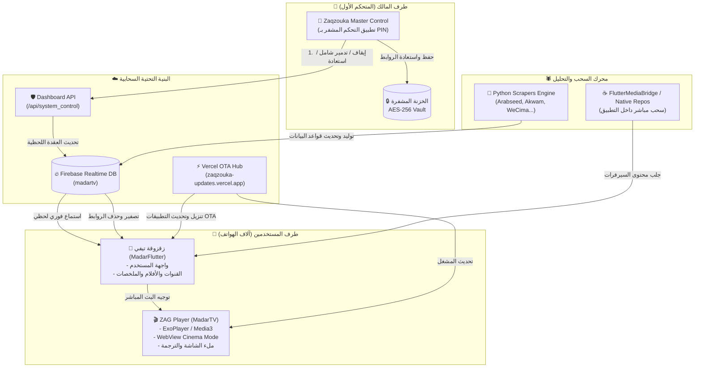

# 🗺️ خريطة المشروع وهيكلية المنظومة (Project Map & Architecture)

> هذا المستند يوضح الهيكل التنظيمي الكامل لمجلد المشروع `iptv app` وكيف تتكامل جميع الأنظمة والتطبيقات البرمجية معاً كمنظومة سحابية واحدة.

---

## 🏗️ المخطط العام للمنظومة (High-Level Architecture)



---

## 📁 خريطة المجلدات الشاملة في مساحة العمل

```text
iptv app/
├── MadarFlutter/              # كود تطبيق العميل الأساسي (Flutter / Dart / Android)
│   ├── lib/                  # شاشات التطبيق، المنطق البرمجي، والاستماع لفايربيس
│   │   ├── main.dart         # نقطة الانطلاق، الاستماع لأمر التدمير، وقفل التطبيق
│   │   └── src/              # الشاشات: sports.dart, recaps.dart, details.dart
│   └── android/              # كود الأندرويد الأصلي والـ MethodChannels
│       └── app/src/main/kotlin/com/madar/
│           ├── madar_flutter/ # FlutterMediaBridge و MainActivity (دعم مسح الكاش)
│           └── tv/data/       # محركات السحب المباشرة (Arabseed, Akwam, WeCima)
│
├── MadarTV/                  # مشغل الفيديو الأصلي (ZAG Player - Android Studio Project)
│   └── madar-player/         # مكتبة المشغل وتطبيق المشغل المتقدم
│       └── src/main/java/com/madar/player/
│           └── PlayerActivity.kt # الكود العملاق للمشغل (ExoPlayer + WebView Cinema)
│
├── ZaqzoukaMasterControl/    # تطبيق المالك للتحكم المركزي والحماية (Flutter)
│   ├── lib/main.dart         # لوحة مفاتيح PIN، الخزنة المشفرة، وأزرار الطوارئ الثلاثة
│   └── build/.../app-release.apk # نسخة APK الجاهزة لتطبيق المالك
│
├── zaqzouka-vercel-hub/      # مركز التوزيع السحابي والتحديثات الفورية (Vercel)
│   ├── public/
│   │   ├── index.html        # صفحة هبوط عربية راقية لتحميل التطبيقات
│   │   ├── downloads/        # مجلد تحميل النسخ الرسمية المحدثة
│   │   └── updates/android/latest.json # سجل فحص التحديثات والهاشات
│   └── api/                  # الدوال السحابية Serverless (version.js, system_control.js)
│
├── dashboard-api/            # واجهة إدارة المشتركين والتحكم السحابي (Node.js)
│   ├── api/system_control.js # معالجة أوامر الإيقاف والمسح والاستعادة من Vercel
│   └── database.rules.json   # قواعد أمان Firebase Realtime Database
│
├── SCRAPERS_ENGINE/          # المحرك الموحد المتقدم لسحب الأفلام والمسلسلات (Python)
│   ├── scrapers/providers/   # 20+ موقع عربي وعالمي (Akwam, Arabseed, WeCima...)
│   ├── scrapers/adbypass.py  # محرك تخطي الإعلانات والـ Popups وحماية الروابط
│   └── scrapers/extractors.py# مستخرج روابط m3u8 و mp4 والسيرفرات المباشرة
│
├── RELEASE_BINARIES/         # المجلد الموحد الشامل لجميع مخرجات النظام الجاهزة للتثبيت
│   ├── zaqzouka-app.apk      # تطبيق زقزوقة تيفي (العميل)
│   ├── zag-player.apk        # مشغل ZAG Player الأصلي
│   ├── zaqzouka-master-control.apk # تطبيق المالك للتحكم المركزي
│   ├── zag-player.aab        # حزمة Google Play الرسمية
│   └── assets/               # صور الهوية البصرية والأيقونات والبنرات
│
├── دليل_المواقع_والسيرفرات/   # الدليل الفني المفصل لـ 25 موقعاً عربياً وعالمياً وسيرفرات البث
│   ├── 01_عرب_سيد_ArabSeed.md..25_موفي_فليكس_Moviflex.md
│   └── README.md             # الفهرس الشامل لكافة المواقع
│
├── LEGACY_ARCHIVES/          # الأرشيف التاريخي المجمع من سطح المكتب
│   ├── desktop_historical_apks/ # 15 نسخة سابقة وتجريبية من التطبيقات
│   ├── desktop_test_assets/  # صور وفحوصات الاختبار
│   └── MadarTV-fix-2026-10-29/ # حزمة الإصلاح السابقة
│
└── ZAQZOUKA_MASTER_ARCHIVE/  # التوثيق الموسوعي الشامل (هذا المجلد)
```

---

## 🔄 بروتوكول التواصل بين تطبيق العميل والمشغل (Intent Protocol)

عندما يختار المستخدم قناة أو فيلماً أو ملخصاً رياضياً داخل تطبيق العميل (`MadarFlutter`)، يتم إطلاق المشغل (`ZAG Player`) عبر أندرويد Intent مع المعاملات التالية:

| المعامل (Intent Extra) | النوع | الوصف والاستخدام |
| :--- | :--- | :--- |
| `android.intent.extra.TEXT` / `Data` | `Uri/String` | الرابط النظيف للبث أو الفيديو (`.m3u8`, `.mp4`, أو صفحة الويب YouTube/Embed). |
| `title` | `String` | اسم القناة أو المباراة أو الفيلم المعروض على الشاشة. |
| `userAgent` | `String` | ترويسة User-Agent المخصصة لمنع حظر السيرفرات. لليوتيوب نمرر Desktop Chrome. |
| `referer` | `String` | رابط الإحالة لكسر حماية الهوت لينك (Hotlink Protection). |
| `headers` | `Bundle/Map` | ترويسات HTTP إضافية مثل Cookies أو Authorization. |
| `subtitles_enabled` | `Boolean` | حالة الترجمة الافتراضية (مفعلة/معطلة). |

---

## ⚡ بروتوكول التحكم في الطوارئ (Emergency Broadcast)

- تراقب جميع الهواتف المثبت عليها التطبيق العقدة السحابية:
  `https://madartv-default-rtdb.firebaseio.com/system_control.json`
- القيم الممكنة للحالة `system_status`:
  1. **`active` (نشط):** التطبيق يعمل بكامل طاقته ومميزاته دون أي قيود.
  2. **`frozen` (موقوف مؤقتاً):** تظهر للمستخدم فوراً شاشة سوداء كاملة: *"الخدمة متوقفة مؤقتاً لأعمال الصيانة والتطوير"*، ويتوقف المشغل وأي بث شغال في ثانية واحدة.
  3. **`wiped` (تدمير شامل وتصفير):** يُمسح كاش الهاتف فوراً، وتُحذف جميع القنوات والسيرفرات من ذاكرة التطبيق عبر الـ MethodChannel `"cache.clearAll"`، وتصبح شاشة التطبيق بيضاء/فارغة تماماً وكأنه لم يكن هناك أي سيرفر أو رابط على الإطلاق.
