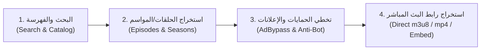

# 🕷️ الدليل الموسوعي لمحرك سحب الأفلام والمسلسلات (Scraping Engine Complete Guide)

> هذا المستند يشرح بالتفصيل الدقيق كل أسرار وتقنيات محرك سحب المحتوى الترفيهي (Movies & TV Series Scraping Engine) داخل منظومة زقزوقة، من أول إرسال طلب البحث حتى استخراج رابط البث المباشر `m3u8` أو `mp4` وتخطي حمايات السيرفرات والإعلانات.

---

## 🎯 دورة حياة عملية السحب (Scraping Pipeline)

تتم عملية جلب أي فيلم أو مسلسل عبر 4 مراحل هندسية متتالية:



---

## 🏛️ المواقع والمصادر المدعومة (Supported Providers)

المحرك مجهز للتعامل مع أكثر من 20 موقعاً عربياً وعالمياً، ويشمل مكتبة واسعة مقسمة حسب النوع:

### 1. عرب سيد (Arabseed - `arabseed.py` / `ArabseedRepository.kt`)
- **رابط النطاق الحالي:** `https://m.arabseed.site` (يتم تحديثه تلقائياً عند تغيير الدومين).
- **آلية البحث:** إرسال طلب `GET` أو `POST` إلى مسار `/find/?find={query}`.
- **استخراج الحلقات:** قراءة وسوم `div.container-episodes` أو `a.episode-link` وتحليل أرقام الحلقات والمواسم.
- **سيرفرات المشاهدة:** الانتقال لصفحة المشاهدة وسحب معرف سيرفر البث الداخلي `watch.php?id=...` واستخراج مشغل `arabseed-player` و سيرفرات Dood, Vidshare, Upstream.

### 2. أكوام (Akwam - `akwam.py`)
- **رابط النطاق:** `https://akwam.to` / `https://ak.sv`.
- **آلية البحث:** استخدام محرك البحث الداخلي `/search?q={query}`.
- **الميزة الحصرية:** يوفر أكوام روابط تحميل وبث مباشرة بجودات متعددة (1080p, 720p, 480p) بدون نوافذ منبثقة مزعجة، وسحب الروابط يتم عبر فك تشفير مسارات التحميل `/download/...`.

### 3. وي سيما (WeCima / MyCima - `wecima.py`)
- **رابط النطاق:** `https://mycima.wecima.show`.
- **آلية العمل:** قراءة عناصر `Grid--WecimaPosts` واستخراج تصنيف المحتوى (أفلام أجنبية، عربية، مسلسلات).
- **صفحة السيرفرات:** يحتوي وي سيما على تبويبات سيرفرات متعددة (`ul.List--Download--Wecima--Single`). يقوم المحرك بمحاكاة النقر على كل تبويب لاستخراج سيرفرات Uqload, Fembed, و Vidbom.

### 4. فاصل إعلاني (FaselHD - `faselhd.py`)
- **رابط النطاق:** `https://www.faselhd.club`.
- **الميزة:** أقوى مصدر للأفلام والمسلسلات الأجنبية والأنمي المترجم بجودة البلوراي.
- **سحب السيرفرات:** يتم استخراج كود الفيديو المضمن داخل `iframe[src*="player"]` وتحليل معرف البث المباشر.

### 5. عرب ليونز وشاهد فور يو وسيما كلوب وإيجي بست:
- `arablionz.py`: متميز في المحتوى الكلاسيكي والأفلام العربية الحصرية.
- `shahid4u.py`: تغطية واسعة للمسلسلات الرمضانية والخليجية والتركية المدبلجة.
- `egybest.py` & `egydead.py`: مكتبة الأفلام العالمية المترجمة والمسلسلات الغربية.

---

## 🛡️ محرك تخطي الإعلانات والحمايات (AdBypass Engine - `adbypass.py`)

أهم تحدٍ في المواقع العربية هو وجود عشرات الإعلانات المنبثقة (Popups)، صفحات إعادة التوجيه الإجبارية (Shorteners)، وحمايات الكلاود فلير.

### كيف يتعامل محرك المنظومة مع هذه العوائق؟
1. **قائمة حظر الإعلانات الصارمة (AdBlock Blacklist):**
   - يتم حظر أكثر من 150 شبكة إعلانية وتتبع في الوقت الفعلي (مثل PopAds, PropellerAds, Adsterra, Bet365, 1xBet, AdMaven).
   - يتم حظر طلبات الشبكة لهذه العناوين داخل `shouldInterceptRequest` في الـ WebView و إرجاع استجابة فارغة (Status 200 فارغ) حتى لا تستهلك إنترنت أو تبطئ الهاتف.

2. **منع النوافذ المنبثقة برمجياً (Popup Block):**
   - في مشغل الفيديو: تم إلغاء `onCreateWindow` في `WebChromeClient` ليرجع `false` دائماً.
   - في المتصفح الخفي: يتم حقن دالة جافاسكريبت لتعطيل `window.open`:
     ```javascript
     window.open = function() { return null; };
     ```

3. **كسر حماية الهوت لينك (Hotlink / Referer Protection):**
   - بعض السيرفرات (مثل Streamwish, Vidcloud, Arabseed) ترفض تشغيل الفيديو إذا لم تكن ترويسة `Referer` قادمة من نفس دومين الموقع الأصلي.
   - يقوم كود Kotlin و Python بتمرير نفس رابط صفحة التضمين في ترويسة `Referer` و `Origin` تلقائياً لكل طلب بث.

---

## ⚡ مستخرجات سيرفرات الفيديو المباشرة (Video Host Extractors - `extractors.py`)

عندما يجد المحرك رابط سيرفر طرف ثالث، يتم تمريره إلى الـ Extractor المتخصص لتحويله إلى رابط مباشر:

| اسم المستخرج | نوع السيرفر | النتيجة المستخرجة |
| :--- | :--- | :--- |
| **DoodStream Extractor** | `doodstream.com / dood.li` | رابط MP4 سريع عبر استدعاء مسار `/pass_md5/` وتوليد التوكن اللحظي. |
| **Streamtape Extractor** | `streamtape.com` | فك تشفير كود جافاسكريبت واستخراج المسار المخفي من عنصر `robotlink`. |
| **Vidshare / Filelions** | `vidshare.com / filelions.to` | استخراج ملف الماستر مانيست `master.m3u8` متعدد الجودات. |
| **Upstream Extractor** | `upstream.to` | فك تشفير سكريبتات Packer (`eval(function(p,a,c,k,e,d)...`) وجلب مسار HLS. |
| **YouTube Extractor** | `youtube.com` | التحويل التلقائي إلى مشغل السينما بدون إعلانات وبجودة 1080p. |

---

## ☕ محرك السحب الأصلي داخل كود الأندرويد (Native Kotlin Repositories)

لكي يعمل تطبيق الهاتف بسرعة البرق ودون الحاجة لتشغيل سيرفر بايثون خارجي، تم تضمين خوارزميات السحب مباشرة بلغة Kotlin داخل حزمة الأندرويد:

1. **`FlutterMediaBridge.kt`**:
   - جسر التواصل بين واجهة Flutter ومحركات السحب الأصلية.
   - يتلقى طلبات البحث واستخراج الحلقات عبر الـ MethodChannel `"com.madar.tv/media"`.

2. **`ArabseedRepository.kt`**:
   - كود مكتوب بـ Kotlin Coroutines و OkHttp و Jsoup لسحب محتوى عرب سيد في أجزاء من الثانية.

3. **`MultiProviderRepository.kt`**:
   - محرك البحث المجمع الذي يرسل طلب البحث إلى عدة مواقع في نفس اللحظة (Parallel Fetching) ويدمج النتائج ويرتبها حسب الأحدث والأعلى جودة.

4. **`SeriesCatalogParser.kt`**:
   - المنطق البرمجي لفهرسة المواسم والحلقات وترتيبها تصاعدياً (من الحلقة 1 إلى الأخيرة) مع تحديد السيرفرات المتوفرة لكل حلقة.
