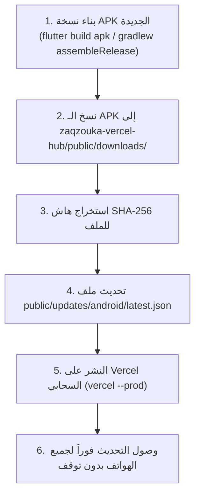

# 🌐 مركز التوزيع السحابي والتحديثات الفورية (Vercel OTA Hub)

> هذا المستند يوضح كيفية إدارة، رفع، ونشر تحديثات التطبيقات عبر منصة **Vercel** بنظام التحديث الهوائي الفوري (Over-The-Air Updates - OTA).

---

## 🎯 دور مركز التوزيع (Distribution Hub)

تم تصميم مركز التوزيع السحابي `zaqzouka-vercel-hub` ليكون المصدر الموثوق والسريع لتحميل التحديثات لجميع مستخدمي المنظومة في أي مكان في العالم بسرعة فائقة وبدون الحاجة لانتظار مراجعات متجر جوجل بلاي.



---

## 📂 محتويات مجلد `zaqzouka-vercel-hub`

```text
zaqzouka-vercel-hub/
├── public/
│   ├── index.html        # صفحة هبوط عربية راقية بتصميم ذهبي/ليلي للتحميل المباشر
│   ├── downloads/        # ملفات التطبيقات الجاهزة للتحميل المباشر
│   │   ├── zaqzouka-app.apk            # تطبيق العميل
│   │   ├── zag-player.apk              # مشغل ZAG Player
│   │   └── zaqzouka-master-control.apk # تطبيق المالك
│   └── updates/android/latest.json     # سجل الإصدارات الرسمية
├── api/
│   ├── version.js        # API استعلام سريع يرجع رقم الإصدار
│   └── system_control.js # معالجة أوامر الإيقاف والمسح والاستعادة
└── vercel.json           # إعدادات التوجيه والـ CORS
```

---

## 📜 هيكل ملف التحديثات (`latest.json`)

هذا الملف هو المرجع الأساسي لتطبيق العميل والمشغل لمعرفة هل يوجد تحديث جديد أم لا:

```json
{
  "packageName": "com.madar.madar_flutter",
  "versionCode": 76,
  "versionName": "1.0.71",
  "releaseNotes": "تحديث زقزوقة الجديد: حل مشكلة ميلان الشاشة، إخفاء كتم الصوت بالكامل، وتفعيل الترجمة الاحترافية، وربط نظام التحكم اللحظي والأوامر الطارئة.",
  "apkUrl": "https://zaqzouka-updates.vercel.app/downloads/zaqzouka-app.apk",
  "sha256": "bad9e5b78083abf12a66e86108604419f7c3167b38b3a8f760d818b15fc48eb6",
  "player": {
    "versionCode": 28,
    "versionName": "1.1.28",
    "releaseNotes": "مشغل ZAG Player المحدث: حل ميلان الشاشة والبار الأسود، إزالة أيقونة كتم الصوت، تشغيل الملخصات والفيديوهات بملء الشاشة، ودعم الترجمة.",
    "apkUrl": "https://zaqzouka-updates.vercel.app/downloads/zag-player.apk",
    "sha256": "efbc2254c3df8cf8f9e04cf23c02237e568767f956d8d6cf3d7985ef4830c9bf"
  },
  "masterControl": {
    "versionCode": 1,
    "versionName": "1.0.0",
    "releaseNotes": "تطبيق زقزوقة للتحكم المركزي والحماية الكاملة (إيقاف فوري - تدمير شامل عليا وعلى أعدائي - استعادة شاملة).",
    "apkUrl": "https://zaqzouka-updates.vercel.app/downloads/zaqzouka-master-control.apk",
    "sha256": "26a4e05101e5ff430644b2111897948eb51a33a9a7b858f41b1aff87d292e89e"
  }
}
```

---

## 🚀 خطوات رفع تحديث جديد إلى Vercel مستقبلاً

عندما تقوم بعمل أي تعديل وترغب في نشره فورياً لكل الناس:

1. **بناء التطبيق الجديد:**
   ```bash
   # لتطبيق العميل
   cd MadarFlutter
   flutter build apk --release

   # لمشغل الفيديو
   cd ../MadarTV
   ./gradlew :madar-player:assembleRelease
   ```

2. **نسخ الملفات إلى مجلد التحميلات:**
   ```powershell
   Copy-Item 'MadarFlutter\build\app\outputs\flutter-apk\app-release.apk' 'zaqzouka-vercel-hub\public\downloads\zaqzouka-app.apk' -Force
   Copy-Item 'MadarTV\madar-player\build\outputs\apk\release\madar-player-release.apk' 'zaqzouka-vercel-hub\public\downloads\zag-player.apk' -Force
   ```

3. **حساب الهاش الجديد عبر بايثون أو باورشيل:**
   ```powershell
   Get-FileHash 'zaqzouka-vercel-hub\public\downloads\zaqzouka-app.apk' -Algorithm SHA256
   ```

4. **تحديث `latest.json`** وزيادة `versionCode` بمقدار 1 ووضع الهاش الجديد ورسالة التحديث.

5. **الرفع إلى Vercel بضغطة زر واحدة:**
   ```bash
   cd zaqzouka-vercel-hub
   vercel --prod
   ```
   *بمجرد اكتمال الأمر، تظهر نافذة التحديث فوراً لجميع المستخدمين عند فتح التطبيق مع زر "تحديث الآن" المباشر.*
