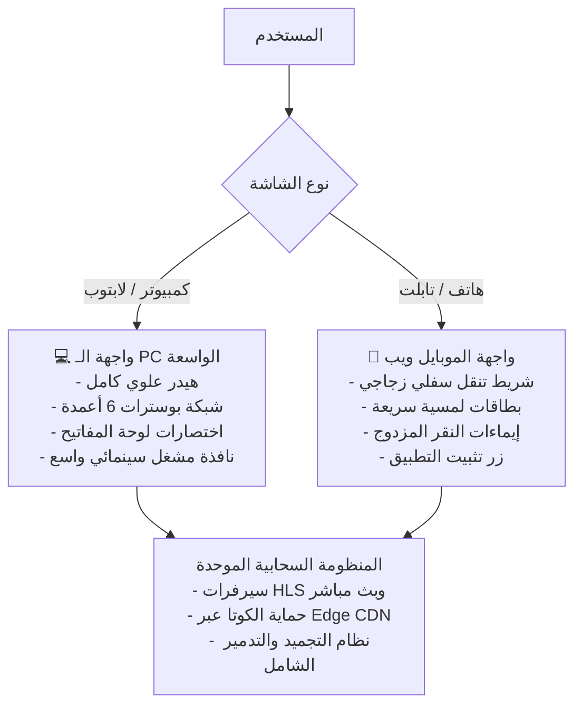

# 🌐 11 — منصة الويب الشاملة وتجربة المستخدم (Web Platform Ecosystem & UI/UX)

> **تاريخ التحديث:** نوفمبر 2026  
> **الإصدار:** Web v1.0.0 (متوافق ومتطابق بنسبة 100% مع تطبيق فلاتر v1.0.71 ومشغل ZAG Player v1.1.28)  
> **رابط النشر الرسمي:** `https://web-hassans-projects-ff23176e.vercel.app`

---

## 🎯 مقدمة ونظرة عامة

تمت ترقية وتطوير موقع الويب الرسمي لمنظومة **زقزوقة TV** ليصبح مطابقاً في كافة وظائفه ومحتواه لتطبيق الأندرويد، مع تصميم وتجربة مستخدم (UI/UX) مخصصة تماماً لشاشات الكمبيوتر (PC Desktop) وشاشات الهواتف المحمولة (Mobile Web).

---

## 💻 1. تجربة مستخدم شاشات الكمبيوتر (PC Desktop UI/UX)

تم بناء الواجهة لاستغلال المساحة العريضة للشاشات الكبيرة (1080p, 2K, 4K) بأعلى فخامة وانسيابية:

### أ. الهيدر العلوي المضيء (Sticky Glassmorphism Header):
- **الهوية البصرية:** شعار زقزوقة TV الذهبي والبلوري محاط بهالة متوهجة مع عنوان المنصة.
- **روابط الأقسام السريعة:** (الرئيسية، أفلام، مسلسلات، أنمي، ملخصات، مباشر، قائمتي).
- **مؤشر البث المباشر (Live Ticker):** شارة حمراء نابضة تُظهر عدد المباريات الجارية الآن لحظياً.
- **شريط البحث السريع:** مزود باختصار لوحة المفاتيح (`Ctrl + K` أو `/`) للتركيز الفوري في حقل البحث.
- **نافذة تحميل التطبيقات:** زر مخصص يفتح نافذة أنيقة لتحميل ملفات `zaqzouka-app.apk` و `zag-player.apk` مباشرة من الـ CDN.

### ب. البنر السينمائي الدوّار (Featured Hero Carousel):
- دوران تلقائي كل 7 ثوانٍ بين أفضل 5 أعمال مميزة مع إمكانية التبديل اليدوي بنقاط المؤشر.
- **مقياس الخط التكيفي (Dynamic Adaptive Title Sizing):** مقتبس ومطابق لكود الفلاتر، بحيث لا يُقطع اسم الفيلم أو المسلسل الطويل مهما بلغ طوله.
- خلفية بانورامية ضبابية متوهجة (Ambient Blurred Glow) تضفي طابعاً سينمائياً راقياً.
- أزرار تشغيل مباشر، تفاصيل، وسيرفرات المشاهدة مع تقييم IMDb وسنة الإنتاج.

### ج. اختصارات لوحة المفاتيح الكاملة للمشغل (Keyboard Shortcuts):
- <kbd>Space</kbd> / <kbd>K</kbd>: تشغيل / إيقاف مؤقت.
- <kbd>F</kbd>: الدخول والخروج من وضع ملء الشاشة (Fullscreen).
- <kbd>M</kbd>: كتم / تشغيل الصوت فوراً.
- <kbd>C</kbd>: تشغيل أو إيقاف الترجمة الفورية (Subtitles / CC).
- <kbd>A</kbd>: التبديل بين أبعاد الشاشة (احتواء كامل / ملء الشاشة / تمدد).
- <kbd>←</kbd> / <kbd>→</kbd>: تقديم وتأخير 10 ثوانٍ.
- <kbd>↑</kbd> / <kbd>↓</kbd>: رفع وخفض الصوت بنسبة 10%.
- <kbd>N</kbd> / <kbd>P</kbd>: الانتقال المباشر للحلقة التالية أو السابقة في المسلسلات.
- <kbd>Esc</kbd>: إغلاق المشغل والعودة للكتالوج.

---

## 📱 2. تجربة مستخدم الهواتف المحمولة (Mobile Web UI/UX)

تم تحسين واجهة الموبايل لتعطي إحساس التطبيق الأصلي (Native Feel):

- **شريط التنقل السفلي (Bottom Navigation Bar):** مثبت أسفل الشاشة بتأثير زجاجي مع دعم حواف الشاشة الآمنة (Safe-Area Insets).
- **درج البحث السريع:** زر بحث في الأعلى يفتح حقل إدخال انسيابي بملء الشاشة مع تركيز تلقائي.
- **اللمس والتمرير الأفقي (Swipeable Chips):** شريط تصنيفات أفقي سلس يتيح التنقل بين الأفلام الأجنبية، العربية، التركية، الأنمي، والأكشن.
- **إيماءات النقر المزدوج بالمشغل:** النقر على نصف الشاشة الأيمن يقدم 10 ثوانٍ، ونصفها الأيسر يؤخر 10 ثوانٍ.
- **معالجة كتم الصوت التلقائي للمتصفح:** عند حظر المتصفح لتشغيل الصوت التلقائي، يظهر بانر عائم متوهج ونابض: `🔊 الصوت مكتوم تلقائياً — اضغط هنا لتشغيله` لفك الكتم بنقرة واحدة.

---

## 🎬 3. مزايا مشغل الفيديو (ZAG Player Web Edition)

تمت ترقية المشغل في [PlayerModal.tsx](file:///c:/Users/hassa/Desktop/all%20project/iptv%20app/06_WEB_AND_DISTRIBUTION/web/src/components/PlayerModal.tsx) ليتطابق مع مشغل الأندرويد:

| الميزة | الوصف الفني |
|---|---|
| **الترجمة الفورية (CC Toggle)** | زر مخصص للترجمة يدعم تفعيل وإلغاء الترجمة واختيار ملفات الترجمة المدمجة بـ HLS. |
| **مبدل السيرفرات الداخلي (Server Switcher)** | قائمة منسدلة داخل شريط التحكم تتيح التبديل الفوري بين السيرفرات دون الحاجة لإغلاق المشغل. |
| **محرك توفير الإنترنت (5 Bandwidth Tiers)** | أوضاع استهلاك ذكية: (HD موفر، أقصى توفير، جودة متوازنة، جودة المصدر الخام، أعلى أداء). |
| **أبعاد العرض وحذف الحواف السوداء** | أوضاع (Contain, Cover, Fill) تملأ شاشات الهواتف والـ Ultrawide بالكامل. |
| **وضع صورة داخل صورة (PiP)** | مشاهدة البث في نافذة عائمة أثناء تصفح باقي المواقع والبرامج. |
| **التحميل المباشر** | زر لتحميل الحلقة أو الفيلم مباشرة بصيغة MP4 على جهاز المستخدم. |

---

## 🛡️ 4. حماية الكوتا والتحكم المركزي (Quota Guard & Remote Wipe)

الموقع متصل بالكامل بنظام الحماية السحابي المركزي:

1. **التحقق من حالة النظام:** يستعلم [KillSwitchProvider.tsx](file:///c:/Users/hassa/Desktop/all%20project/iptv%20app/06_WEB_AND_DISTRIBUTION/web/src/components/KillSwitchProvider.tsx) عن endpoint السحابي `https://zaqzouka-dashboard-api.vercel.app/api/status`.
2. **استغلال Edge CDN:** الاستعلام يستخدم الكاش لـ 60 ثانية، مما يعني أن ملايين زيارات الويب تستهلك 0 اتصال من كوتا Firebase المجانية.
3. **أمر التجميد (Freeze):** يعرض فوراً شاشة الصيانة الفاخرة مع عداد إعادة المحاولة.
4. **أمر التدمير الشامل (Wipe):** ينفذ `localStorage.clear()` ويمسح جميع المحفوظات وسجلات المشاهدة والكوكيز ويقفل الموقع نهائياً.

---

## 📁 5. المسارات البرمجية في المنظومة

- **كود الويب المصدري:** `06_WEB_AND_DISTRIBUTION/web/`
- **مكون شريط التنقل:** `src/components/Navbar.tsx`
- **مكون الكتالوج والبنر:** `src/components/CinemaView.tsx`
- **مكون التفاصيل وسيرفرات البث:** `src/components/DetailView.tsx`
- **مكون المشغل السينمائي:** `src/components/PlayerModal.tsx`
- **مكون البث المباشر والمباريات:** `src/components/LiveTvView.tsx`
- **مكون حماية الكوتا والتدمير:** `src/components/KillSwitchProvider.tsx`

---

*تاريخ التوثيق: نوفمبر 2026*
