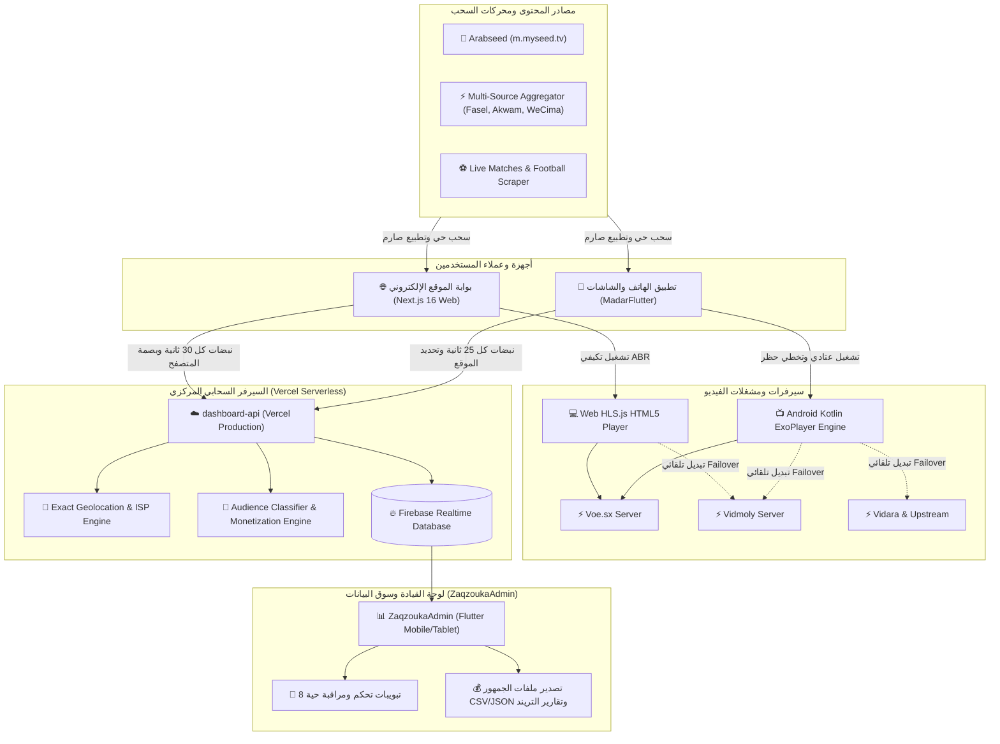
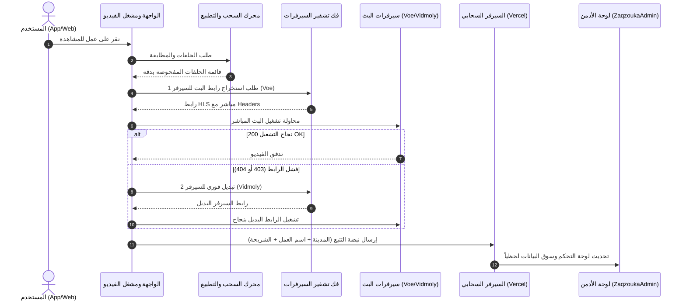

# 🗺️ المخطط الشامل التكاملي لمنظومة زقزوقة (System End-to-End Master Blueprint)
**الإصدار:** 14 Moon  
**تاريخ التوثيق:** 16 نوفمبر 2026  
**النطاق التكاملي:** Mobile App + Web Portal + Native Player + Cloud Telemetry + Admin Dashboard + Data Monetization  

---

## 📑 الفهرس
1. [المخطط المعماري الشامل للمنظومة (High-Level Architecture Diagram)](#1-المخطط-المعماري-الشامل-للمنظومة)
2. [دورة حياة الطلب من البداية للنهاية (End-to-End Request Lifecycle)](#2-دورة-حياة-الطلب-من-البداية-للنهاية)
3. [مخطط تدفق البيانات وتبديل السيرفرات (Data Flow & Failover Pipeline)](#3-مخطط-تدفق-البيانات-وتبديل-السيرفرات)
4. [الفهرس البنائي الشامل لمجلدات المستودع (Complete Workspace Inventory)](#4-الفهرس-البنائي-الشامل-لمجلدات-المستودع)
5. [أدلة البناء والتشغيل والنشر السحابي (Build, Run & Deployment Runbook)](#5-أدلة-البناء-والتشغيل-والنشر-السحابي)
6. [صيانة ومراقبة النسخة 14 Moon (Maintenance & Operations Guide)](#6-صيانة-ومراقبة-النسخة-14-moon)

---

## 1. المخطط المعماري الشامل للمنظومة
يوضح المخطط التالي كيفية اتصال كافة الأطراف ببعضها البعض:



---

## 2. دورة حياة الطلب من البداية للنهاية (End-to-End Request Lifecycle)

### السيناريو: مستخدم يفتح فيلماً أو مباراة في التطبيق أو الموقع:
1. **الخطوة 1: بدء الجلسة والتتبع الجغرافي (Session Inception):**
   - بمجرد فتح التطبيق، يستعلم عميل التتبع عن الـ IP ويحدد المدينة بدقة (مثل: `طنطا، الغربية، مصر (EG)`).
   - يتم إرسال طلب `POST /api/telemetry/session/start` إلى السيرفر السحابي مع بصمة الجهاز ومزود خدمة الإنترنت.
   - تظهر الجلسة فوراً في لوحة الأدمن بشارة خضراء `🟢 نشط الآن`.
2. **الخطوة 2: اختيار المحتوى والتحقق الصارم (Bilingual Token Matching):**
   - ينقر المستخدم على عمل (مثال: "مسلسل العتاولة الموسم 2").
   - تقوم خوارزمية `Title Matcher` بفحص روابط الحلقات للتأكد بنسبة 100% أنها تتبع العمل ذاته وليست فيلماً أجنبياً أو صفحة وهمية (Soft-404).
3. **الخطوة 3: فك تشفير سيرفرات المشاهدة (Stream Resolution):**
   - يتم جلب قائمة السيرفرات (Voe, Vidmoly, Vidara, Upstream).
   - يقوم محرك الـ Resolvers بفك حزم الـ JavaScript وتجاوز الـ Anti-Hotlink عبر تمرير ترويسات `Referer` الأصلية.
4. **الخطوة 4: خطوة إعلان الفيديو (VAST Pre-Roll) إن وُجدت:**
   - فحص وجود إعلان فيديو لمدة 15 ثانية؛ إذا اكتمل أو انتهت مهلته (2.5 ثانية timeout)، يبدأ البث المباشر.
5. **الخطوة 5: التشغيل والمراقبة اللحظية (Playback & Heartbeat):**
   - يبدأ المشغل (ExoPlayer في الأندرويد، أو HLS.js في الويب).
   - إرسال نبضة `ping` دورية كل 25 ثانية مع اسم الفيلم والشريحة الإعلانية المحسوبة تلقائياً (مثل: `🍿 جمهور الترفيه والمنوعات`).
6. **الخطوة 6: التبديل التلقائي في حال توقف السيرفر (Automatic Failover):**
   - في حال حدث خطأ 403 أو تقطيع مستمر في السيرفر الأول، ينتقل المشغل فوراً إلى السيرفر الثاني في القائمة دون إيقاف التطبيق أو إشعار المستخدم بخطأ.
7. **الخطوة 7: إنهاء الجلسة (Session Termination):**
   - عند إغلاق التطبيق أو مغادرة الموقع، يتم إرسال إشعار إنهاء الجلسة `POST /api/telemetry/session/end` فتتحول الجلسة في لوحة الأدمن إلى `⚪ منتهية` مع الاحتفاظ بكافة بياناتها التحليلية.

---

## 3. مخطط تدفق البيانات وتبديل السيرفرات (Data Flow & Failover Pipeline)



---

## 4. الفهرس البنائي الشامل لمجلدات المستودع (Complete Workspace Inventory)

```
iptv app/
├── documents for/                    # 📚 التوثيق الشامل الكامل للمنظومة (الإصدار 14 Moon)
│   ├── 01_ZAQZOUKA_TV_MOBILE_APP.md  # توثيق تطبيق الهاتف والشاشات بنسبة 100%
│   ├── 02_ZAQZOUKA_WEB_PORTAL.md     # توثيق موقع الويب والبوابة الإلكترونية
│   ├── 03_ZAQZOUKA_VIDEO_PLAYER_ENGINE.md # توثيق مشغلات الفيديو وفك التشفير والتبديل
│   ├── 04_ZAQZOUKA_ADMIN_AND_TELEMETRY_BACKEND.md # توثيق لوحة الأدمن وسوق البيانات والـ API
│   ├── 05_FULL_SYSTEM_END_TO_END_BLUEPRINT.md # المخطط المعماري الشامل وتدفق العمليات
│   └── README.md                     # الفهرس الرئيسي ودليل التنقل السريع
│
├── MadarFlutter/                     # 📱 تطبيق الهاتف والشاشات الرئيسي (Flutter)
│   ├── android/                      # إعدادات الأندرويد، الـ Manifest، وأكواد Kotlin الأصلية
│   ├── lib/                          # واجهات التطبيق، شاشات الأفلام والمسلسلات والمباريات
│   │   ├── main.dart                 # نقطة الدخول الرئيسية، نظام الثيمات، ومراقبة دورة الحياة
│   │   ├── screens/                  # الشاشات: الرئيسية، الأفلام، المسلسلات، الأنمي، المباريات
│   │   └── src/                      # خدمات السحب، التتبع الجغرافي، وجسر الربط
│   └── pubspec.yaml                  # الاعتماديات وحزم الـ Flutter
│
├── web/                              # 🌐 بوابة الموقع الإلكتروني (Next.js 16 App Router)
│   ├── src/app/                      # مسارات الصفحات ومسارات الـ Serverless API الداخلية
│   ├── src/components/               # مشغل HLS، بطاقات العرض، وأشرطة التنقل
│   ├── src/lib/                      # محركات السحب المباشر (arabseed, aggregator, analytics)
│   └── package.json                  # إعدادات وحزم بيئة Node.js و TypeScript
│
├── dashboard-api/                    # ☁️ السيرفر السحابي المركزي (Vercel Serverless Functions)
│   ├── api/                          # نقاط النهاية (telemetry, stats, export audience, trends)
│   ├── api/_lib.js                   # قاموس التعريب الجغرافي ومحرك تصنيف شرائح الجمهور
│   └── vercel.json                   # إعدادات التوجيه السحابي ونشر Vercel
│
├── ZaqzoukaAdmin/                    # 📊 تطبيق لوحة تحكم الأدمن (Flutter Mobile/Tablet)
│   ├── lib/main.dart                 # الأقسام الثمانية بالكامل، سوق الداتا والإعلانات، والجلسات الحية
│   └── pubspec.yaml                  # حزم التطبيق والاعتماديات
│
├── SCRAPERS_ENGINE/                  # ⚙️ محركات السحب المجمعة وسيرفرات الفحص
└── scrapers/                         # سكريبتات فك التشفير والاختبار الفردية للمزودات
```

---

## 5. أدلة البناء والتشغيل والنشر السحابي (Build, Run & Deployment Runbook)

### 1. بناء حزمة تطبيق زقزوقة للهاتف والشاشات (MadarFlutter APK):
```bash
cd MadarFlutter
flutter clean
flutter pub get
flutter build apk --release
# يخرج ملف APK في: build/app/outputs/flutter-apk/app-release.apk
```

### 2. بناء حزمة تطبيق لوحة الأدمن (ZaqzoukaAdmin APK):
```bash
cd ZaqzoukaAdmin
flutter clean
flutter pub get
flutter build apk --release
# يخرج ملف APK في: build/app/outputs/flutter-apk/app-release.apk
```

### 3. تشغيل ونشر موقع الويب (Next.js Web Portal):
```bash
cd web
npm install
npm run build
npm run start # للتشغيل المحلي على منفذ 3000
# للنشر على Vercel:
npx vercel --prod
```

### 4. نشر السيرفر السحابي وسوق البيانات (dashboard-api):
```bash
cd dashboard-api
npx vercel --prod --yes
# النطاق الحي: https://zaqzouka-dashboard-api.vercel.app
```

---

## 6. صيانة ومراقبة النسخة 14 Moon (Maintenance & Operations Guide)
1. **مراقبة التتبع الجغرافي:** التأكد دورياً من أن الجلسات الحية تسجل المدينة باللغة العربية عبر لوحة الأدمن (تبويب 2).
2. **تحديث الكتالوج التلقائي:** يتم تحديث أعمال ومباريات اليوم تلقائياً عبر استدعاءات الـ API الحية بدون تدخل بشري.
3. **تصدير ملفات الداتا أسبوعياً أو شهرياً:** استخدام أزرار التصدير في تبويب **سوق الداتا والإعلانات 💎** لتوليد ملفات CSV المحدثة للجمهور وتقديمها لشبكات الإعلانات أو سماسرة الـ DMP.
