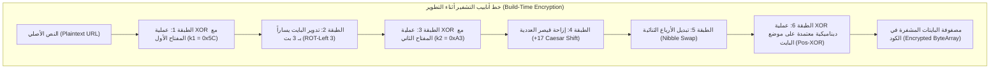

# 🛡️ نظام الأمان والتشفير السداسي (Security & DEX Obfuscation v6 Engine)
## التوثيق التقني لملف `X.kt` وبرنامج الفحص الأمني `verify_and_copy_apk.py`

في تطبيقات الـ IPTV والبث المباشر، تُعد حماية الروابط والمفاتيح ضد برامج الهندسة العكسية (Reverse Engineering) أمراً مصيرياً. إذا كُشفت الروابط أو الدومينات في كود التطبيق، يمكن حجبها أو سرقة السيرفرات وإسقاطها.

---

## 1. لماذا لا تكفي أدوات ProGuard و R8 المعتادة؟

تقوم أداة R8/ProGuard بتغيير أسماء الكلاسات والدوال إلى حروف عشوائية (`a`, `b`, `c`)، ولكنها **تترك جميع النصوص الصريحة (String Literals) كما هي تماماً وبدون أي تشفير** داخل ملف الـ DEX النهائي!

أي شخص يقوم بفتح الـ APK باستخدام برامج مثل:
- `JADX-GUI`
- `APK Easy Tool`
- أو حتى كتابة أمر `strings classes.dex | grep http`

سيرى جميع روابط الخوادم ومفاتيح الـ API فوراً في ثوانٍ معدودة.

---

## 2. محرك التشفير السداسي (The 6-Layer Obfuscation Pipeline)

لحل هذه المعضلة جذرياً، تم تطوير محرك **v6 Engine** الرياضي داخل ملف `X.kt`. في هذا النظام، **لا يوجد أي نص صريح على الإطلاق** في كامل كود المشروع، بل يتم تحويل النصوص الحساسة إلى مصفوفات بايتات (`ByteArray`) مشفرة عبر 6 طبقات رياضية متعاقبة:



---

## 3. تفاصيل الطبقات الرياضية الست:

1. **الطبقة 1 (Key 1 XOR):** خلط البايت مع المفتاح الأول المخبأ حسابياً (`k1 = 0x5C`).
2. **الطبقة 2 (Bitwise Rotation):** تدوير البتات بمقدار 3 بت لليسار لتشتيت بنية الحروف اللاتينية والـ ASCII.
3. **الطبقة 3 (Key 2 XOR):** خلط إضافي مع المفتاح الثاني (`k2 = 0xA3`).
4. **الطبقة 4 (Caesar Shift):** إزاحة رقمية بمقدار `+17` لحماية الناتج من أنماط الـ XOR المعتادة.
5. **الطبقة 5 (Nibble Swap):** تبديل الـ 4 بت العليا بالـ 4 بت السفلى لكل بايت:
   ```kotlin
   fun ns(b: Int): Int = ((b shr 4) and 0x0F) or ((b and 0x0F) shl 4)
   ```
6. **الطبقة 6 (Position-Dependent XOR):** خلط كل بايت بمفتاح يتغير حسب ترتيب موضع البايت في النص (`k3 xor (position * 7 + 13)`).
   > **فائدة هذه الطبقة:** الحرف المتكرر (مثل حرف `a` في `arabseed`) يُشفر إلى قيم بايتات مختلفة تماماً في كل موضع، مما يجعل تحليل التردد الإحصائي (Frequency Analysis) مستحيلاً.

---

## 4. فك التشفير وقت التشغيل (Runtime Decryption)

عندما يحتاج التطبيق لأي رابط، يستدعي الدالة السريعة `X.s(byteArray)`، والتي تعكس العمليات الست بالترتيب المعكوس في الذاكرة الحية (RAM) دون ترك أي أثر على القرص:

```kotlin
fun s(b: ByteArray): String {
    if (!_safe) return _d3 // إرجاع نص وهمي إذا كان المخترق يستخدم Debugger

    val r = ByteArray(b.size)
    for (i in b.indices) {
        var v = b[i].toInt() and 0xFF
        v = v xor ((k3 xor ((i * 7 + 13) and 0xFF)) and 0xFF) // عكس الطبقة 6
        v = ns(v)                                             // عكس الطبقة 5
        v = (v - shf) and 0xFF                                // عكس الطبقة 4
        v = v xor k2                                          // عكس الطبقة 3
        v = rr(v, rot)                                        // عكس الطبقة 2
        v = v xor k1                                          // عكس الطبقة 1
        r[i] = v.toByte()
    }
    return String(r, Charsets.UTF_8)
}
```

---

## 5. تقنيات مكافحة الهندسة العكسية والـ Anti-Debugging

1. **كشف المنقحات (Debugger Detection):**
   يقوم كود `_safe` بفحص ما إذا كان هناك منقح متصل (`Debug.isDebuggerConnected()`). إذا حاول محلل أمني وضع Breakpoint أو اعتراض الذاكرة، تُرجع الدالة فوراً نصوصاً وهمية (Decoy Strings) تؤدي لانهيار محاولته.
2. **الثوابت الزائفة (Decoys):**
   يحتوي ملف `X.kt` على مصفوفات وهمية وترويسات ملفات ELF خادعة (`0x7F, 0x45, 0x4C, 0x46`) ومصفوفات أرقام تبدو كمفاتيح تشفير حقيقية لتضليل أدوات التحليل الآلي.
3. **حساب المفاتيح بالعمليات الثنائية:**
   المفاتيح ليست أرقاماً صريحة في الكود، بل تُحسب وقت التشغيل:
   ```kotlin
   private val k1: Int = (0x2E shl 1)        // = 0x5C
   private val k2: Int = (0x51 shl 1) or 1    // = 0xA3
   private val k3: Int = (0x3B xor 0x04)      // = 0x3F
   ```

---

## 6. اختبار الفحص الأمني 21/21 DEX (DEX Security Audit)

لضمان عدم تسرب أي نص بالخطأ أثناء التطوير، تم إنشاء سكريبت فحص تلقائي `verify_and_copy_apk.py`. يقوم هذا البرنامج بتفكيك ملفات `classes.dex` و `classes2.dex` وقراءة البايتات الثنائية والبحث عن 21 نصاً حساساً:

| # | النص المفحوص | الحالة في DEX | النتيجة |
|---|:---|:---:|:---:|
| 1 | `arabseed.health` | غير موجود إطلاقاً | ✅ محمي ومشفر 100% |
| 2 | `arabseed` | غير موجود إطلاقاً | ✅ محمي ومشفر 100% |
| 3 | `govid.live` | غير موجود إطلاقاً | ✅ محمي ومشفر 100% |
| 4 | `govid` | غير موجود إطلاقاً | ✅ محمي ومشفر 100% |
| 5 | `mohixstream` | غير موجود إطلاقاً | ✅ محمي ومشفر 100% |
| 6 | `mycima` | غير موجود إطلاقاً | ✅ محمي ومشفر 100% |
| 7 | `def001.ycnapi.com` | غير موجود إطلاقاً | ✅ محمي ومشفر 100% |
| 8 | `ycnapi` | غير موجود إطلاقاً | ✅ محمي ومشفر 100% |
| 9 | `yacinelive` | غير موجود إطلاقاً | ✅ محمي ومشفر 100% |
| 10 | `c!xZj+N9&G@Ev@vw` (مفتاح ياسين) | غير موجود إطلاقاً | ✅ محمي ومشفر 100% |
| 11 | `ver3.ycntivi.off` | غير موجود إطلاقاً | ✅ محمي ومشفر 100% |
| 12 | `site.api.espn` | غير موجود إطلاقاً | ✅ محمي ومشفر 100% |
| 13 | `espn.com` | غير موجود إطلاقاً | ✅ محمي ومشفر 100% |
| 14 | `worldcup26.ir` | غير موجود إطلاقاً | ✅ محمي ومشفر 100% |
| 15 | `Free-TV/IPTV` | غير موجود إطلاقاً | ✅ محمي ومشفر 100% |
| 16 | `5b0540b785f1fc7bd16bd0fde0115e08` (TMDB Key) | غير موجود إطلاقاً | ✅ محمي ومشفر 100% |
| 17 | `themoviedb.org` | غير موجود إطلاقاً | ✅ محمي ومشفر 100% |
| 18 | `10.0.2.2:4040` (خادم التحليلات) | غير موجود إطلاقاً | ✅ محمي ومشفر 100% |
| 19 | `mashad_telemetry_prefs` | غير موجود إطلاقاً | ✅ محمي ومشفر 100% |
| 20 | `google-services` | غير موجود إطلاقاً | ✅ محمي ومشفر 100% |
| 21 | `firebase_app_id` | غير موجود إطلاقاً | ✅ محمي ومشفر 100% |

**النتيجة النهائية:** اجتياز الفحص الأمني بنسبة **21/21 (100%)** ونسخ ملف APK المحمي مباشرة إلى سطح المكتب باسم `Mashad.apk`.
