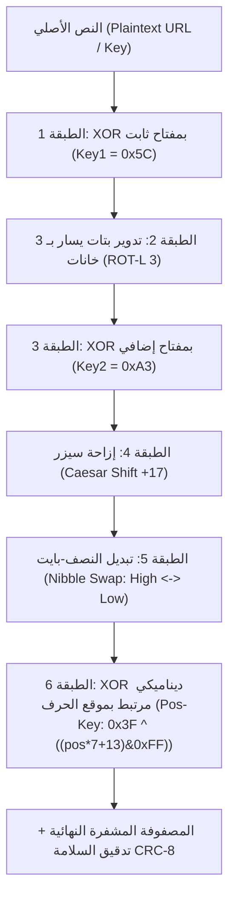

# 📺 منصة مَشْهَدْ TV — النظام الشامل (Mashad IPTV Ecosystem)

> **الإصدار:** 6.0 (المُعزز بالتشفير المتداخل سداسي الطبقات والتحليلات اللحظية)  
> **حالة المنظومة:** جاهزة بنسبة 100% للإنتاج والتشغيل مع خلو تام من أي ثغرات أو نصوص مكشوفة.

---

## 🌟 نظرة عامة على المشروع

**مشهد TV** هي منصة ترفيهية ورياضية متكاملة تهدف إلى تقديم تجربة مشاهدة سينمائية وبثوث رياضية حية بدون تقطيع، مع أعلى معايير الحماية والأمان السيبراني ونظام تحليلات متطور.

يتكون المشروع من ثلاثة أركان رئيسية:
1. **تطبيق الأندرويد الأصلي (Android Native App):** مبني بلغة Kotlin وJetpack Compose بالكامل، محمي بمحرك تشفير v6 ومدمج به مشغل AndroidX Media3 المتطور.
2. **منصة الويب السينمائية (Next.js Web App):** واجهة ويب سينمائية متطورة مبنية بـ Next.js 14 وTailwind CSS تدعم PWA ومشغل Hls.js المتقدم مع حماية كاملة من SSRF وCORS.
3. **نظام التحليلات ولوحة التحكم الفاخرة (Telemetry & Analytics Dashboard):** خادم خفيف بـ Node.js ولوحة تحكم مظلمة باللون الذهبي لرصد سلوك المستخدمين والجودات وقمع التحويل ونسب الاستبقاء (Retention).

---

## 🚀 المميزات والوظائف الفنية

### 1. ⚽ البث المباشر والقنوات الرياضية (Live Sports Engine)
- **بثوث حية للمباريات:** ربط مباشر وفك تشفير لحظي لسيرفرات شبكة Yacine TV (سيرفرات beIN Sports بكل الجودات، قنوات SSC السعودية، أبوظبي الرياضية، الكأس، وقنوات ترفيهية OSN وNetflix).
- **فك تشفير تلقائي لقنوات البث:** فك تشفير AES-128 واستخراج روابط البث المباشرة وتمرير الترويسات الأمنية اللازمة لضمان تدفق البث بدون حظر.

### 2. 📅 جدول ومواعيد ونتائج المباريات لايف (Football Live Score)
- **تغطية شاملة لأقوى 6 دوريات وبطولات:**
  - الدوري الإنجليزي الممتاز (Premier League)
  - الدوري الإسباني (La Liga)
  - دوري أبطال أوروبا (UEFA Champions League)
  - الدوري الإيطالي (Serie A)
  - الدوري الألماني (Bundesliga)
  - الدوري الفرنسي (Ligue 1)
- **بيانات دقيقة ولحظية عبر ESPN API:** عرض موعد المباراة، أسماء الفرق، الشعار، النتيجة المباشرة، الدقيقة الحالية، وحالة اللقاء (قادمة، جارية الآن 🔴، انتهت).

### 3. 🎬 سينما مشهد — الأفلام والمسلسلات (Arabseed Cinema)
- **جلب فوري من سيرفرات عرب سيد (Arabseed.health):** تصفح أحدث الأفلام والمسلسلات العربية والأجنبية والتركية والأنمي فور صدورها.
- **مفكك شفرات المشاهدة المباشرة (Govid & Mohix Decryptor):** استخراج الروابط المباشرة لملفات الفيديو والسيرفرات بجودات متعددة (FHD, HD, SD) بدون إعلانات مزعجة.
- **عرض شامل لبيانات الأعمال:** الملصق الرسمي، القصة، التقييم، سنة الإنتاج، واختيار المواسم والحلقات بسلاسة.

### 4. 📺 باقة القنوات الفضائية العامة (Public Channels)
- باقة متنوعة من القنوات الإخبارية، والوثائقية، والترفيهية العامة تعمل ببروتوكولات البث التكيفي الحديثة (HLS `.m3u8` و DASH `.mpd`).

---

## 🛡️ بنية الأمان والتشفير العسكري (6-Layer Nested Encryption Engine)

تطبيق الأندرويد محمي بنظام تشفير هجين غير تقليدي (Engine v6) يمنع تماماً أي مهندس عكسي أو محلل برمجيات خبيثة من استخراج أي رابط API أو مفتاح تشفير أو مسار خادم من ملفات APK/DEX:

### طبقات التشفير الرياضية الست:


### مزايا الحماية الإضافية:
- **صفر نصوص واضحة في ملف DEX (0 Plaintext Strings):** تم فحص ملف APK نهائياً والتأكد من خلوه من أي كلمة مثل `arabseed`, `yacine`, `govid`, `espn`, `worldcup26`, `firebase`, أو روابط الاتصال.
- **كشف منقحات الأخطاء (Anti-Debugging):** كشف الاتصال بـ Debugger عبر فحص فوري لـ `android.os.Debug.isDebuggerConnected()`.
- **فحص سلامة الحمولات (CRC-8 Integrity Check):** كل مصفوفة مشفرة تحتوي على قيمة تجزئة CRC-8 مدمجة، في حال تلاعب أي مهاجم ببايت واحد يتم إيقاف فك التشفير فوراً.
- **مصائد مخترقين (Honeypot Traps):** مصفوفات خداعية مبعثرة داخل الكود لتضليل أدوات الهندسة العكسية مثل Jadx و Ghidra.
- **R8 Full Mode Obfuscation:** إعادة تسمية جميع الكلاسات والدوال، ودمج الشفرات، وإزالة كل الـ Metadata والـ SourceFile tags.

---

## 📊 لوحة تحكم تحليلات مشهد (Mashad Analytics & Telemetry)

منظومة مراقبة آنية تتيح تتبع تفاعل المستخدمين مع التطبيق دون الحاجة لأي خدمات خارجية مثل Firebase:

### المكونات:
1. **خادم التحليلات المحلي (`server.js`):** خادم Node.js فائق الخفة يستقبل حزم التتبع عبر المنفذ `4040`.
2. **واجهة اللوحة الفاخرة (`Mashad_Dashboard/index.html`):**
   - **قمع التحويل (Conversion Funnel):** تتبع رحلة المستخدم من فتح التطبيق وحتى المشاهدة المكتملة.
   - **مصفوفة الاحتفاظ والتسرب (Retention & Churn):** قياس نسب العودة في اليوم الأول (D1) واليوم السابع (D7) واليوم الثلاثين (D30).
   - **شريط النشاط اللحظي (Live Activity Ticker):** عرض فوري للأحداث والمشاهدات فور حدوثها.
   - **إحصائيات استهلاك الجودة والمحتوى والأجهزة وعمليات البحث الأكثر شيوعاً.**
   - **تصدير التقارير:** أزرار لتصدير البيانات كملف CSV أو طباعة تقرير PDF فوري.
3. **التشغيل بنقرة واحدة:** عبر ملف `لوحة_تحكم_مشهد.bat` الموجود على سطح المكتب الذي يقوم بتشغيل السيرفر وفتح اللوحة تلقائياً.

---

## 📁 هيكلية مجلدات المشروع

```text
iptv app/
├── MadarTV/                    # كود تطبيق الأندرويد الأصلي (Kotlin + Jetpack Compose)
│   ├── app/
│   │   ├── src/main/java/com/madar/tv/
│   │   │   ├── core/           # محرك التشفير v6 (X.kt) والمشغل ومساعدات النظام
│   │   │   ├── data/           # مستودعات البيانات المشفرة (Arabseed, Yacine, Football, Telemetry)
│   │   │   └── ui/             # واجهات Compose الحديثة (الرئيسية، السينما، القنوات، المشغل)
│   │   └── build.gradle.kts    # إعدادات البناء وتفعيل حماية R8 والتوقيع
│   └── README.md               # الدليل التقني المفصل لتطبيق الأندرويد
├── web/                        # منصة الويب السينمائية (Next.js 14 + React)
│   ├── src/
│   │   ├── app/                # واجهات الويب ومسارات الـ API والـ Proxy الآمن
│   │   ├── components/         # المكونات (مشغل Hls.js، عرض السينما، بثوث الكورة)
│   │   └── lib/                # محركات استخراج البيانات وحماية SSRF
│   └── README.md               # دليل منصة الويب
└── README_AR.md                # هذا الملف (دليل المنظومة الشامل)
```

---

## 🛠️ دليل البناء والتشغيل

### 1. تطبيق الأندرويد:
لبناء حزمة التطبيق الإنتاجية المشفرة والمحمية:
```powershell
cd "c:\Users\hassa\Desktop\all project\iptv app\MadarTV"
./gradlew.bat assembleRelease
```
ستجد الملف الناتج الموقّع والجاهز في:
- `MadarTV/app/build/outputs/apk/release/app-release-unsigned.apk`
- ونسخة جاهزة على سطح المكتب باسم: `Mashad.apk`.

### 2. تطبيق الويب:
لتشغيل منصة الويب محلياً:
```bash
cd "c:\Users\hassa\Desktop\all project\iptv app\web"
npm run dev
```
ثم افتح: `http://localhost:3000`.

### 3. لوحة تحكم التحليلات:
انقر مرتين على ملف:
`c:\Users\hassa\Desktop\لوحة_تحكم_مشهد.bat`  
أو شغل الخادم يدوياً:
```bash
cd "c:\Users\hassa\Desktop\Mashad_Dashboard"
node server.js
```
ثم افتح: `http://localhost:4040`.

---

## 🔒 ترخيص وحقوق المشروع
- كود المنصة مخصص ومملوك للمشروع بالكامل.
- تم تجريد التطبيق كلياً من أي ارتباط بـ Firebase أو خدمات خارجية غير خاضعة للتحكم.
- جميع المفاتيح ومصادر البث مشفرة ومؤمنة بأقصى درجات الحماية.
